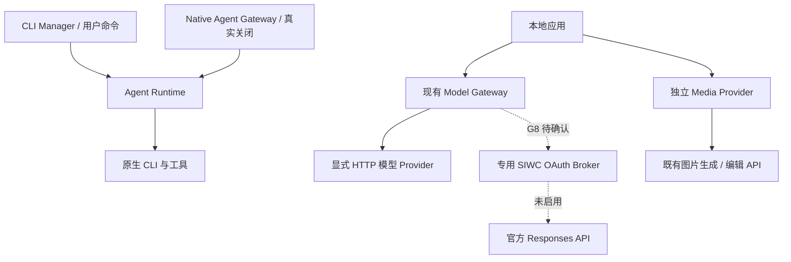

# xcli 总体架构

更新：2026-11-10 / G8。保留 CLI Manager、Agent Runtime、Model Gateway、Native Agent Gateway 与 G1–G7 历史代码及证据。

| 组件 | 职责 | 凭据与执行边界 | 当前状态 |
| --- | --- | --- | --- |
| CLI Manager | CLI 发现、配置、安装/版本诊断和用户选用入口 | 不从原生登录提取 Token，不为业务应用提供模型额度 | 保留现有命令与管理功能；历史移除命令不恢复。 |
| Agent Runtime | 用户直接发起 Task/Run、CLI argv 适配、会话、预算、取消和验证产物 | 真实原生 Agent 可有文件/工具能力，使用其自身授权；不是纯模型 API | 保留。 |
| Native Agent Gateway | 独立 `/agent/v1` 任务、客户端/归属、事件、预算和 Artifact 交付 | 原生工具执行及认证边界必须单独成立，不能借 Model Gateway 绕过 | G7 `PARTIAL_HOST_ISOLATION_ONLY`；真实 Profile 默认关闭，本轮停止隔离实验。 |
| Model Access Gateway | 授权的模型文本/Vision 请求、流、取消、模型目录、上下文与应用鉴权 | 纯 HTTP 模型 I/O；SIWC OAuth 属专用 broker，不进工具进程 | 现有 Model Gateway 保留；G8 SIWC 为离线契约，生产资格/架构 BLOCKED。 |
| Media Gateway | 独立图片生成/编辑 Provider 与媒体字节验证/交付 | 独立凭据、参数、费用和能力验证；不借用 SIWC 图片输入宣称生成 | 现有 `model.ImageBackend`、HTTP images 和 `media` 保留；独立产品称谓不代表本轮新建服务。 |

SIWC 计划是应用自身 OAuth → Responses，不继承 Agent Runtime/CLI 的订阅登录、不经过 Codex app-server、不启动 Shell/MCP/工具。当前不注册 `siwc-responses` 生产 backend，也没有 `/v1/responses`。普通 API Key 模型 Provider 继续保留，但不能作为 SIWC 验收。

文本、Vision 和图片生成是不同能力；GardenFlow 后续可保留已有 Qwen-Image 2.1 API 独立做媒体，不把它标为 SIWC image_generation。四应用本轮没有被修改或迁移。

G8 的正式资格审查、OAuth 生命周期、契约、安全存储与后续门禁见 [Model Access Gateway](model-access-gateway/README.md)。G7 最终状态见 [G7 决策](native-agent-gateway/G7_DECISION.md)。历史 [CLI-first 架构](cli-first/INTEGRATION_ARCHITECTURE.md)保留其原验收语境，不用于宣布当前 SIWC 或原生 Profile 已可用。
