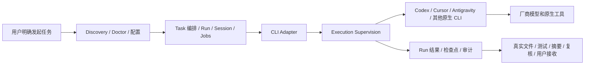

# xcli 总体架构 · R4

2026-11-10 / CLI-First Product Realignment。xcli 统一调度 AI Coding Agent CLI，供应商原生 CLI 自管安装、登录、账号、权限、额度和模型授权。

| 核心模块 | 当前实现与边界 |
| --- | --- |
| CLI Discovery / Doctor | PATH、配置、版本/help、声明能力；不主动登录或猜测额度。 |
| CLI Adapter | Codex、Cursor、Antigravity 及已有其他 Adapter 的 argv、事件、Session、退出与用量解析。 |
| Task / Workflow Orchestrator | Task 协调/执行/修复/复核、串行角色、累计预算、材料交接；内部 workflow 与旧后台兼容保留，独立 workflow 命令不恢复。 |
| Session / Run / Jobs | 原生 Session 与 Run/Task ID 分离；后台日志、查询、取消、继续与历史。 |
| Execution Supervision | owner/attempt、OS 锁、进程组取消、心跳、超时、失活收敛与 reconcile。 |
| Result / Artifact Management | 实际文件/摘要、worktree/diff、当前内容验证与复核；执行成功不能代替文件或语义接收。 |
| 配置、日志、任务审计 | 版本兼容、私有存储、结构化事件、必要诊断；不集中供应商凭据。 |

冻结模块：`model*`、Native Agent Gateway HTTP/`agentapi/agentstore/agentservice/...`、`siwc`、OAuth Credential Manager 设计和通用 Media Provider。`model`/`agent-gateway` 从主帮助隐藏，服务/探针/授权创建默认拒绝；保留兼容性查询、停止、撤销及 disable。实验 opt-in 不能启用真实 Native Profile 或 SIWC。

当前仍是一个源码构建产物，`cmd` 引用实验包，NAG 共享 `modelstore` 的安全存储工具，媒体校验共享 `media`。本轮不物理删除包/依赖，也不宣称已分成安全隔离的二进制。核心 `task/run/use/resume` 的运行数据路径不调用这些 HTTP 服务，不要求 Gateway 配置或 OAuth。

未来应用只讨论受限本机 Task API/IPC：用户选择 Agent、工作区、输入、输出和预算；状态、取消、证据与结果交付。不复用冻结 NAG 服务假装应用接口已可用，也不开放模型代理/订阅共享。详见 [R4 架构](product-realignment/ARCHITECTURE.md)、[模块处置](product-realignment/MODULE_DISPOSITION.md)与[应用接入](product-realignment/APPLICATION_INTEGRATION_GUIDE.md)。

M0–M5、G1–G8 的代码及证据保持历史作用域。G7 仍为 PARTIAL_HOST_ISOLATION_ONLY；G8 仍为离线契约通过/生产 BLOCKED。这些实验结论不再阻塞核心 CLI 任务产品，也不被 R4 升级为真实服务验收。
