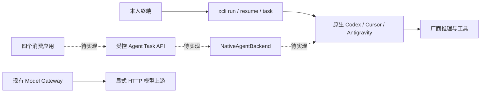

# CLI-first 接入架构（Planned / Blocked）

**本文是设计，不是已实现接口。** 当前 xcli 没有本文中的 HTTP Agent 路由、NativeAgentBackend、媒体 Artifact 服务或原生 CLI 模型 alias。Gate B BLOCKED，四应用不能把现有 Model Gateway endpoint 当作 CLI 能力入口。依据见[报告](ACCEPTANCE_REPORT.md)和[官方资料](OFFICIAL_SOURCES.md)。

## 现状与推荐接口



现有 Agent Runtime 已有 argv 适配、会话/Run、进程组取消、有限事件解析和脱敏进度。现有 Model Gateway 为 HTTP 协议转发，不运行 Agent；两者的权限和状态不可直接混用。历史模型 API 的四应用适配也不会因 Agent 名称相同而自动使用 CLI。

推荐最小方案是本人控制的本机 Agent 任务接口；Codex 优先官方 SDK/app-server，简单批任务可用 exec；Cursor 用官方 headless；Antigravity 可先用单次 print，持续交互再单独验证 stream-json stdin 或 SDK。选择哪条路径需按真实版本、审批和媒体验收决定。正式 ChatGPT OAuth 路径是另一项需要独立授权的集成，不从原生登录中提取凭据。

## 最小 NativeAgentBackend

以下均为待实现的接口职责，不新增或宣称已有 Go API：

| 职责 | 输入/输出与限制 |
| --- | --- |
| Discover | Agent ID、安装版本、认证状态、能力来源/时间/证据；模型身份未知时为空 |
| Start | 客户端、合成输入/授权文件、固定工作区策略、预算；记录启动前扣预算 |
| Events | 原生事件经版本化适配后输出；未知字段不制造成功或增量 |
| Resume | 只恢复同一客户端拥有的会话；保留累计预算与权限，不接受任意 Session ID |
| Cancel | 明确中断/终止与最终状态；有副作用未知时要求 reconcile |
| Artifacts | 只交付经允许路径与真实字节验证的文件；模型返回路径不能直接开放读取 |

不把一次应用文本请求自动交给完整 Task 协调循环；协调/修复可能多次调用，必须计入显式预算。可复用 `internal/agent`、`internal/runtime`、runstore 的边界，新增服务层需独立认证、生命周期、审批与 Artifact 校验，不在现有 HTTP backend 里偷启 shell。

## 拟议 Agent API 合同

所有 `/agent/v1/*` **目前不存在**。以下 JSON/SSE 为评审示例，不能向当前 xcli 发送并声称可运行。

| 拟议路由 | 语义 |
| --- | --- |
| `GET /agent/v1/capabilities` | 仅列客户端有权使用的 Agent、版本、能力及证据；发现不等于本次可推理 |
| `POST /agent/v1/tasks` | 启动一个显式预算的 Agent 任务，返回任务 ID 和状态，不隐式重试 |
| `GET /agent/v1/tasks/{id}` | 查询执行、验证、用量和文件状态 |
| `GET /agent/v1/tasks/{id}/events` | 认证 SSE，带序号和有限重放 |
| `POST /agent/v1/tasks/{id}/cancel` | 幂等请求取消；收到取消请求不等于已停止 |
| `POST /agent/v1/tasks/{id}/resume` | 校验归属/策略/剩余额度，显式增加新的进程调用 |
| `GET /agent/v1/artifacts/{id}` | 认证后交付已验证的原始图片字节，不暴露任意本机路径 |

拟议任务输入：

```json
{
  "agent_id": "codex",
  "operation": "text_task",
  "input": [{"type": "text", "text": "总结这份合成材料"}],
  "policy_id": "single-user-synthetic-readonly",
  "budget": {"max_process_starts": 1, "timeout_seconds": 120},
  "client_request_id": "synthetic-request-001"
}
```

`agent_id` 是执行入口，不是假造的模型名。只有来自可信原生元数据的 `native_model` 才能填值。操作枚举需分 text_task、vision_task、image_generate、image_edit；未验证操作返回 capability_unverified。输入文件用已授权 Artifact ID，不接受任意绝对路径、URL 或 shell 字符串。应用不能指定 cwd、argv、代理、环境变量或通配权限来绕过服务策略。

拟议结果保留 `execution_status`、`validation_status`、`parse_status`、原生退出码与本地错误类别。只在真实任务完成且所需验证通过时给任务成功；需要文件的任务即使文本“完成”仍可是 `validation_failed`。用量未上报为 `null`，不能填 0 冒充无消耗。原生上报的 token、缓存、累计会话用量要注明来源与统计范围；不推算收费或伪造精确成本。

### SSE

拟议事件：`task.started`、`task.progress`、`text.delta`（确有原生增量时）、`text.completed`、`approval.required`、`artifact.ready`、`task.completed`、`task.failed`。每事件包含版本、任务 ID、递增序号；不透传原始工具参数、账号或完整 stderr。

```text
id: 1
event: task.progress
data: {"version":1,"task_id":"example-task","seq":1,"message":"agent activity"}

id: 2
event: text.completed
data: {"version":1,"task_id":"example-task","seq":2,"text":"示例合成结果"}
```

这是合同示例，不是真实调用证据。仅有最终文本时只能发 completed；不得把最终字符串切片模拟原生增量。Cursor partial 的重复 flush 必须去重；Codex app-server 的 delta 与 exec item 事件不可混同。现有 xcli `--events` 可能合并进度，也没有 HTTP SSE 端点；能力目录必须准确标明。

断线默认不新起模型请求，不自动恢复执行。事件重新连接仅重放已有事件；服务终止或退出状态未知则失败关闭，人工检查副作用后再显式恢复。取消后清理进程组，等待终止确认；图片云任务可能仍继续计费，不能承诺 SIGTERM 撤销厂商端生成。

### 图片字节

拟议 Artifact 元数据包含 `id`、`media_type`、`byte_length`、`width`、`height`、`sha256`、`origin: native_tool`、来源任务及验证结果。下载响应采用真实 `Content-Type`、长度和摘要，保留 PNG/JPEG/WebP 原始格式。URL 不自动下载，不读模型返回的任意路径，不把 JPEG 改后缀当 PNG。

服务需限制普通文件、大小/像素/数量、realpath 根目录及 symlink/TOCTOU；从明确允许的本轮原生产物目录导入私有 Artifact 存储。超出授权根或无法安全关联本任务时 BLOCKED，不能扫描全局历史会话目录找图片。完整解码后校验尺寸/哈希；参考编辑验证输入哈希未变、文件不同、视觉有实质修改且符合提示。局部像素差异/摘要不同都不足以单独证明语义编辑成功。

图片先作为 Agent 文件产物导入。未来若新增 `/v1/images/*` 兼容层，也必须先得到真实有效字节、核对所支持参数，再按字节编码 b64；不能以图片路径、下载 URL 文案或文件名制造 `b64_json`，不能假装支持 n/size/mask/多参考图。

## 认证、隐私与路由

默认同一用户、loopback 字面 IP 或本人 Unix socket；无 LAN、公网、浏览器 CORS 或多租户服务。每应用独立随机客户端授权，服务端仅存摘要，客户端通过 Keyring/受限文件存放；不同于原生登录凭据、既有 Gateway Token 和上游 API Key。客户端授权不能授予全机读写或替代操作系统权限。

路由固定 Agent/会话/策略，无自动换品牌、账号或付费重试。默认每 CLI/会话并发 1，队列、进程数、时间、输出/图片均有上限。进程启动预留预算，失败也记录尝试，不能失败后返还并循环调用。幂等键防止同一动作重复启动，不把网络失败视为安全重试证明。

云推理位置默认为 remote/unknown，任何 localhost 客户端也不能据地址跳过云同意。只导出用户批准的最小材料到任务工作区，避免附带 `.env`、Git 凭据、业务库和历史聊天。xcli 关闭 raw recording 不会关闭厂商端或原生 CLI 的会话留存，应用要在发送前说明实际边界。

进程参数不使用全权限开关；trust、approval、MCP、代理均不自动修改。文本默认只读；媒体只放行本任务需要的文件/原生工具。无法在 headless 交互审批时，返回 approval_required 或 BLOCKED，不扩大权限。业务数据是低信任输入，不得变成修改策略的指令。

## 文本映射到 Chat 的边界

可以评估的最小映射只有“受控单个 user 文本任务 → 验证过的最终 assistant 文本”，仍需独立合同和真实测试。任意 role 顺序、system/developer 优先级、temperature、max_tokens、seed、stop、logprobs、严格 token 预算、工具往返和任意 history 都不能直接映射为提示词拼接并宣称等价。

业务 JSON 可在结果后做解析/Schema 校验；除非原生约束、失败语义和版本都通过，不声明严格 `response_format.json_schema`。Agent 内部工具调用默认不会成为应用的 `tool_calls`；应用侧工具必须独立白名单和审批。没有可靠模型身份、usage 或原生 delta 时为空/不支持，不造数据。Embedding 缺少独立合法后端时保持缺失，不能用 Agent 生成数字充当向量。

## 可用的当前客户端示例（终端桥接，不是 HTTP）

本示例只说明当前源码的 subprocess 调用方法；本轮未作真实推理验收。须在已审批、无敏感材料的 Git 项目中执行，每运行一次会消耗原生额度。

```python
import json
import os
import signal
import subprocess

def synthetic_text(binary, project):
    argv = [binary, "run", "--agent", "codex", "--cwd", project, "--json",
            "仅回复 CLI-FIRST-DEMO，不读文件，不调用工具。",
            "--", "--sandbox", "read-only", "-c", 'approval_policy="never"']
    proc = subprocess.Popen(argv, stdout=subprocess.PIPE, stderr=subprocess.PIPE,
                            text=True, start_new_session=True)
    try:
        stdout, _ = proc.communicate(timeout=120)
    except subprocess.TimeoutExpired:
        os.killpg(proc.pid, signal.SIGTERM)
        try:
            proc.communicate(timeout=5)
        except subprocess.TimeoutExpired:
            os.killpg(proc.pid, signal.SIGKILL)
            proc.communicate()
        raise RuntimeError("native_timeout; no automatic retry") from None
    if proc.returncode != 0:
        raise RuntimeError("native_execution_failed; no automatic retry")
    result = json.loads(stdout)
    if result.get("status") != "success" or result.get("parse_status") != "complete":
        raise RuntimeError("native_result_invalid")
    if result.get("output", "").strip() != "CLI-FIRST-DEMO":
        raise RuntimeError("semantic_marker_failed")
    return result
```

真实消费应用不应在 UI 进程直接使用这段代码执行任意 prompt；要先补上述认证、审批、输入隔离和 Artifact 合同。当前脚本也不替代四应用接入工程。

## 工程优先级与改造验收

| 优先级 | 需要单独确认的工程任务 | 完成门槛 |
| --- | --- | --- |
| P0 | 补齐已授权的三 CLI 文本/媒体真实基线 | 每次启动有账本、最终标记、文件与原生工具证据；不改全局设置 |
| P1 | 新增独立 Agent 服务/NativeAgentBackend，复用 agent/runtime/runstore；认证、策略、预算、取消、会话归属 | 离线权限拒绝、跨客户端越权、断线/未知状态、预算耗尽、进程组清理；再批准小额真实 HTTP → CLI 测试 |
| P2 | 增加安全 Artifact 导入/下载、MIME/解码/摘要和参考编辑验证 | 拒绝 symlink、越界路径、伪图、超限、输入覆盖、虚假图片结果 |
| P3 | 四应用新增 Agent 模式适配，不替换既有 HTTP 模型模式 | 各自合成任务、云拒绝零调用、权限/取消/断连、Keyring、媒体入库验收；UI 另行授权 |
| P4 | 仅对确可映射能力增加可选兼容层 | 明确参数白名单与拒绝矩阵，真实 model alias/模型身份/流/usage 验收后才发布 |

本轮没有实施这些新服务，不申请部署或发布。先交付真实能力证据，再按选定最小范围实现与验收；不能靠给现有后端改名字关闭 Gate B。
