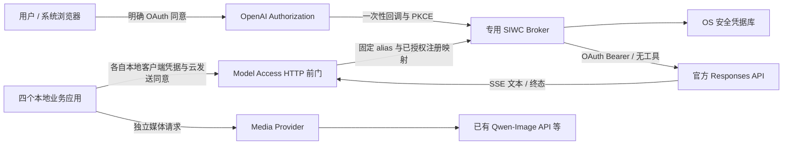

# G8 架构

状态：设计与离线契约，生产接入 BLOCKED。总体分层见 [xcli 总体架构](../ARCHITECTURE.md)。

## 目标数据路径

图中 SIWC 路径是待确认目标，不是当前服务路由。当前 HTTP `/v1/responses` 返回 404（未鉴权为 401），`siwc-responses` 配置在加载时被拒绝。没有新增生产端口或后台服务。

## 边界与部署

CLI Manager 管理发现与配置；Agent Runtime 管理本人发起的原生任务；Native Agent Gateway 管理其独立任务协议；Model Access Gateway 只做授权模型 I/O；Media Gateway 只做媒体生成/编辑及媒体字节处理。它们可以共享非敏感结构，不能共享 OAuth 凭据域、原生认证、任意文件读取或执行权限。

未来生产 SIWC broker 应是独立签名身份的专用进程/服务；仅具有浏览器授权控制面、OS 凭据库和官方 HTTPS 出口。不把 Token 装进有 Agent Runtime、Shell、MCP、插件或任意工具执行入口的进程。当前同仓库/同二进制不等于已实现 OS 隔离；专用发布产物、Keychain ACL 与跨进程 IPC 验收是下一阶段工程门禁。

前门默认 loopback 字面 IP；检查 Host、拒绝浏览器 Origin/CORS，按应用单独发行随机本地 Token，服务端仅留摘要。Token 的本地凭据与 OAuth Token 完全独立，不接受 OAuth Bearer 作为应用凭据。每应用固定 alias、remote consent、并发/速率限制。应用不能指定上游 URL、OAuth client/账号/host、代理、环境、cwd 或工具。

统一还是分应用 OAuth 注册由官方答复决定。服务端受信映射是 `{local client ID → allowed model aliases → allowed registration}`，不能由请求体自报。当前既有 `model.Client` 尚未有 OAuth 注册绑定字段；真实路由接入之前必须补齐，不能用当前模型白名单假装已隔离账号。

控制面负责交互式登录、账号选择、撤销和状态；业务数据面只见安全状态和模型输出。登录 URL、ID Token、callback code 和 refresh 请求不开放给四应用。切换账号须完成身份验证、原子持久化后才切换；在途请求使用固定注册快照，不允许混用新旧账号。

## 历史与资源

每次 HTTP Responses 请求带完整 `input` 数组，禁用 HTTP `previous_response_id` 和远端 conversation 依赖。可由调用方发送完整显式消息，或未来由 broker 管理；二者必须明确选定，不能重复拼接。

G8 `History` 是内存消息契约，键包含本地应用、OAuth 注册和 conversation。它只在验证完成后提交，30 分钟 TTL，最多 32 会话，每个完整请求最多 4 MiB/4096 条消息；不静默截断。返回副本，账号退出清理该注册历史。最坏内存约 128 MiB 加结构开销；生产需再加全局字节限额和敏感数据保留选择。

本轮不保存 opaque reasoning/encrypted items；只传显式 developer/user/assistant 文本及合格图片。未来无状态 reasoning 连续性需要另行扩充并验收，不能把本契约描述为 Responses 全量历史实现。

无隐式重试、无账号/模型/计费自动切换。取消必须关闭上游 HTTP 请求和 body，局部输出不能提交历史。`response.completed` 才算成功。目录是可选模型提示，不是权益证明。

## 本轮代码范围

`internal/siwc` 生产源码只有协议、校验、内存历史和 fail-closed 凭据接口；无网络/文件/进程 API。Mock HTTP client/server 与模拟凭据库只在 Go 测试构建中存在。没有实现原生 Keychain、生产 OIDC discovery、跨进程刷新锁、生产 Provider 或应用集成。该约束使资格未明时仍可验证可复用契约，同时保持真实模型请求为零。
