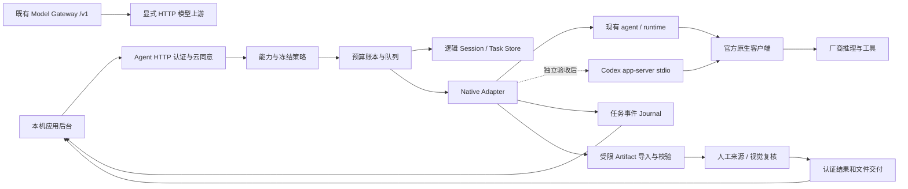

# Native Agent Gateway V1 — Design

状态：Proposed，2026-11-06。本文描述拟议实现；只有[验收基线](../cli-first/ACCEPTANCE_REPORT.md)和下面注明的源码能力已存在。规范字段见 [API_CONTRACT.md](API_CONTRACT.md)。

## 架构决策

新增本人本机控制的 Agent Task 服务，独立进程、固定 loopback 字面 IP 监听、独立授权与状态根。推荐命令命名为 `xcli agent-gateway ...`，本轮不注册命令。V1 不做系统启动项；Unix socket 可后续增加，不是首版验收必选。Model Gateway 保留原 `/v1` HTTP 上游路线。

服务的一个 Task = 一个 user turn 的 dispatch；一个 Session = 一个客户端、一个材料领域、一个固定适配器的有序上下文。现有 `internal/task.Task` 是可能规划、委派、修复多轮的工作流；HTTP Task 不调用其 Runner。命名相同不代表状态或预算相同。

V1 优先 `codex-exec-v1` / `antigravity-print-v1`，利用现有真实基线；Cursor 实现适配但保留 trust 阻断。先完成官方 [SDK / app-server 比较](CLI_ADAPTER_MATRIX.md)，以同一内部接口隔离传输差异，后续只能显式切换新 Session。

## 源码评估与复用边界

| 现有源码 | 可复用部分 | 必须新增/修正的服务边界 |
| --- | --- | --- |
| `internal/agent/agent.go` | Registry、固定 CommandSpec、Run/Resume argv，含 Codex resume 参数转换 | 不接受应用传入 `extra`、Config.Env 或 executable；server 管理不可变配置快照 |
| `internal/agent/stream.go` | 分块 JSONL、大小上限、terminal、quota、denied_actions、Normalize | 增加 typed observer 和独立错误原因；保留原事件 API；不把声明能力发布为 verified |
| `internal/agent/diagnostics.go` | 有界 stderr 扫描模式与特定 Agy 拒绝识别 | 当前只覆盖窄错误模式，需版本化 trust/auth/denial 分类；不能只看最后 stderr tail |
| `internal/agent/usage.go` | token/cache/reasoning 归一化 | 新结果需字段级 nullable、来源/累计范围；旧结构不能恢复已丢失的“未知 vs 0” |
| `internal/runtime/execution.go` | context 生命周期、解码与进度队列 | 当前进度可丢弃/合并；增加不可丢的状态 observer；sink 写入的是本地 journal，不是 SSE 连接 |
| `internal/runtime/process*.go` | 单进程/进程组、TERM→2 秒→KILL、I/O 错误 | 不能直接保证云端撤销；需 worker 身份/重启处理和受测的总清理上限 |
| `internal/runtime/environment.go` | PWD 规范化等逻辑 | BuildEnvironment 先继承全部环境，再叠加配置；服务必须先构造最小 allowlist，禁止应用自定义 env，不直接使用 os.Environ() |
| `internal/runstore/store.go` | 私有文件模式、原子写、Run 记录 | 没有客户端归属、队列事务、幂等、结果正文和事件日志；不是服务主存储；SessionID fallback 不是原生身份观察证据 |
| `cmd/run_exec.go` / `cmd/resume.go` | 前后台、resume 选择与结果应用经验 | CLI 可以接受任意原生 ID/cwd，不可将命令 handler 直接暴露为 HTTP；服务直接调用受控库 |
| `internal/task/*` | checkpoint 先写 in-flight、累计预算、needs_reconcile 的模式 | 不调用多轮 Runner，不复用 OwnerToken 充当应用凭证，不自动继承 roleArgs 的权限模式 |
| `internal/worktree/*` | 隔离工作区与摘要校验经验 | V1 不把四应用仓库直接挂给 Agent；使用服务管理的合成/选材目录，仓库 worktree 后续另验 |
| `internal/modelgateway/server.go` | loopback、Host/Origin、Bearer、响应头、限流的模式 | 不直接复用 Client/模型权限语义；HTTP 请求断连取消逻辑不适用于持久 Agent Task |
| `internal/modelstore/clients.go` / `private*.go` | 随机 Token、摘要比较、锁与 0700/0600 存储方法 | 可提取通用私有存储工具；新 Token namespace/权限/状态根，不共用 Model 客户端文件 |
| `internal/model/image.go` | PNG/JPEG/WebP、先尺寸后解码、20 MiB/16M 像素校验 | 提取纯图片校验工具可两边调用；不把 model.Error 暴露为 Agent wire error；新增安全文件导入/来源/复核 |
| `tests/r0/native_media.py` / `native_audit.py` | 字节/视觉分层、透明转发与工具清单非调用证据的测试 | 仅作验收工具；广泛原生目录白名单、mtime 与文本路径提取不能成为服务读取授权；不自动查历史会话日志 |
| `cmd/model.go` / `internal/modelstore/config.go` | 现有 HTTP Gateway 完整保留 | 不增加 native backend、不添加 CLI model alias、不改 Gate B |

结论：进程与基础协议部分复用度高；HTTP 生命周期、持久预算、身份、隔离、Artifact 交付是新增主体。不能通过调用 `xcli run --json` 的薄 HTTP 包装完成 V1。

## 拟议内部模块

| 新模块（路径仅为设计） | 职责 |
| --- | --- |
| `internal/agentgateway` | 路由、授权、严格合同、SSE、错误映射 |
| `internal/agentservice` | Session/Task 状态机、调度、取消、版本固定、结果发布 |
| `internal/agentstore` | 私有单写者日志、事务恢复、幂等、预算、事件与结果 |
| `internal/nativeadapter` | exec/print wrapper；将现有 agent/runtime 映射为 typed observation；未来 app-server 独立实现 |
| `internal/agentpolicy` | 本人注册的策略和安装域、环境 allowlist、沙箱/工具/网络约束、有效 profile 摘要 |
| `internal/agentartifact` | 输入暂存、任务输出导入、解码/来源/审查、下载、清理 |

内部 Driver 合同是 `DiscoverCached`、`StartTurn(ctx, BoundRequest, Observer)`、`Cancel(WorkerHandle)`、`CloseSession`。`BoundRequest` 只包含已校验的会话绑定、服务路径与预算，不含任意命令。Observer 区分 NativeSessionObserved、Terminal、Diagnostic、Usage、TextDelta、Activity、ArtifactCandidate；未知事件只能作为有界诊断，不能生成完成事实。

app-server 需单独的双向 RPC pump、请求 ID 关联和审批拒绝处理。V1 即便评估该路线，也不透传原生 RPC 给应用；禁止 command/exec、process/spawn、配置/插件管理等控制面。worker 不跨客户端共享；初版可每 task 一个独占进程，保留原生 thread ID 以便下次续接，避免共享进程的取消误伤。

## Session、调度与结果

创建 Session 只分配逻辑 ID、冻结 Agent/适配器/二进制摘要、策略 revision、能力 revision、安装域及预算，不启动原生客户端。首次任务返回原生 ID 后绑定；之后只使用该 ID 和原工作区。身份未知时 native_model 为 null。不能导入用户历史原生 ID，也不根据任务文本选择另一个 Agent。

Session 的输入、历史和原生上下文会累积；每次云同意涵盖累计材料摘要。权限/版本/模型选择变化需要新 Session；原生后台账号切换无法靠“不读凭据”可靠检测，V1 禁止有活跃 Session 时自行切换账号，观察到明确认证域变化则封存 Session。不能声称已验证账号身份固定。

状态转移的规范表见 API。主要路径：queued → running → validating → awaiting_review（图片）→ succeeded。blocked/failed/timed_out/canceled/expired/needs_reconcile 是可查询的终态；文本可在验证后直接成功。执行结果、协议完整性、字节检查、来源、语义审查各自保留。终态不能因为晚到“成功”事件翻转。

V1 默认全局并发 1、每原生安装域 1、每 Session 1、有限 FIFO 队列；同 Session 活跃任务冲突直接拒绝。未来增加并发必须按安装域锁，不能从凭据推导账号。全局/客户端/Session 预算同时满足才 dispatch。公平队列、队列超时和取消都不能触发模型请求。

Task 从接受起的 deadline 包括排队、启动、执行、自动验证；人工复核单独有 24 小时 TTL。额外清理硬上限为 5 秒，其中 TERM grace 最多 2 秒，其余用于 KILL/管道收尾。若仍无法确认停止，则进入 needs_reconcile 并隔离 worker，不无限等子进程。需验证现有 RunProcess 在后代持有 pipe 时的行为并补 WaitDelay/有界收尾，不能只相信顶层进程退出。

SSE 断开仅关闭观察者，任务继续受原 deadline/预算控制；停止需要独立 cancel。GET/事件重连不提交新 turn。本地 journal 写失败则立即中止 worker；SSE 消费慢可以断开该连接，不阻塞 CLI 或丢终态。

## 持久化与预算事务

建议首版用 Go 标准库的 append-only 事务 journal + 原子 checkpoint，暂不引入数据库依赖。服务数据根持有独占锁，禁止两实例写同一根。snapshot 是缓存；日志 fsync 的提交记录是恢复依据。每条含版本、单调序号、长度和校验摘要；只允许丢弃未提交的尾部，已提交段损坏必须停服务并报告 store_corrupt。

单笔 `TaskAccepted` 事务包含：客户端与规范化请求摘要、幂等键、Task/Session ID、队列状态；不能分别写文件留下重复创建窗口。`DispatchCommitted` 在任何 native spawn/turn/start 前 fsync，原子记录 invocation_id、Session/客户端/服务额度的扣减和冻结 profile。此后即使 spawn 失败或崩溃，也不返还启动/dispatch 次数。

当前单次执行适配器每 task 扣 1 dispatch、1 process_start。长驻 SDK/app-server 未来仍每 turn 扣 dispatch，只有真实新进程扣 start；不能用一个长驻进程绕过调用预算。内部模型请求数未知，不列为可强制上限。按累计墙钟预留执行时限，结束可释放未使用的时间预留；进程/dispatch 次数永不自动返还。

重启时：未 dispatch 的队列任务转 blocked/service_restarted，不自动启动；已 dispatch 而缺完整持久终态的 Task 转 needs_reconcile，Session 封存。启动前已扣但未确认 spawn 的区间也视为不确定，不补发。只信活的 worker 监督关系/不可伪造句柄和实例代次，不按旧 PID 杀进程。幂等提交在保留窗内重放旧结果，不能保证跨保留期无限 exactly-once。

SDK/CLI 自身可能内部重连、子代理和重试。xcli 不添加自动调用重试，但不能据 1 次进程预算宣称只有 1 次推理。用量原样注明 turn/session/unknown；累计统计缺基线时不可相减为精确本次成本。`remaining_quota`、账单、金额控制不可观测时为空；要求硬金额上限直接拒绝 budget_unenforceable。

本地日预算由本人配置，未配置时 dispatch 上限为 0，服务可查目录但不可推理；不能从本轮剩余额度自动填值。观察到 quota、额外支付或权限拒绝时终止，不买 credits、不修改设置、不换账号/模型/供应商。

## 权限、认证与数据边界

| 边界 | V1 实施条件 |
| --- | --- |
| 网络入口 | 独立端口，literal 127.0.0.1/::1 监听并校验 Host；拒绝 Origin、CORS、代理转发、重定向及 LAN；未认证 health 只报进程存活 |
| 应用身份 | 每应用随机 256-bit Token；只存摘要、权限和版本；独立于原生登录与 Model Gateway Token；撤销即时阻止新读写并取消该客户端活跃任务 |
| 材料 | 应用确认后导出最小选材；只接受上传字节/服务对象 ID；不传业务数据库/仓库根/秘密路径/远程 URL |
| 工作区 | 服务生成 0700 目录，输入不可改、输出单独根；不复制 .env、Git 认证、CLI 登录目录；prompt 不是 OS 权限隔离 |
| 进程环境 | server allowlist；保留运行必要系统项和本人固定的原生根路径；移除 API Keys/ADC、应用 bearer、注入型 loader/shell 变量、任意代理；不叠加自由 Env |
| 工具与插件 | 只有本人注册并可逐次施加的官方策略；拒绝 force/yolo/danger-full-access/skip-permissions、自动审查批准、无审计的 MCP/hooks/plugins |
| 原生认证 | 可信原生程序自行访问现有认证；xcli 不读取/复制 auth 文件、Cookie、Keychain，也不调用私有推理端点；子工具对凭据/其他应用状态的访问必须被受测策略阻断 |
| 云同意 | remote/unknown 必须同时满足客户端 AllowRemote 与本次 consent；一次同意绑定 Session 当前材料及新输入摘要；localhost 不改变推理位置 |
| 审计 | 仅 ID、版本、profile 摘要、状态、动作类别、预算、用量来源、文件哈希；不记录原始 stdout/stderr、prompt、完整工具载荷、Token 或私有路径 |

**可实施性门槛**：现有 CLI 参数不是 xcli 自建安全沙箱；只读不等于不能读全盘，计划模式不等于禁工具。新增 profile 必须证明文件读取、写入、shell/网络和继承工具边界；如无官方逐次开关能约束全局配置，则该 profile 为 policy_unenforceable，不开放真实业务数据。不得为了让媒体运行而默认升到 workspace-write；媒体 profile 需本人单独授权，写权限仅限任务输出。V1 不通过放宽当前默认沙箱来达成可用性。

Token 保护的是合作本机应用的接口访问，不隔离恶意同 UID 程序；不能据此声称多租户安全。运行身份不变更，不偷偷申请宿主全权限。原生客户端/厂商仍可能留存会话，xcli 删除本地材料不代表删除原生或云端历史。

## Artifact 流程

输入只允许受限 UTF-8 文本和 PNG/JPEG/WebP；图片最多 20 MiB、16,777,216 像素。服务确认输入哈希后保存不可变副本，编辑时再校验；应用原始媒体库不提供给原生 CLI。

输出优先落到 task 输出根。Adapter 返回 ArtifactCandidate 只是一条候选，不授权读取；服务通过任务注册的根、文件句柄和原生任务关联验证后导入。若厂商只在自身目录产图，只能使用本人授权的**精确本任务输出子目录或官方返回文件句柄**；不能用整个 .codex/.cursor/.gemini 白名单或扫描最新文件代替。若当前版本不能提供可安全关联的输出，则媒体为 artifact_access_blocked。

导入先确认所有路径分量不经 symlink、普通文件、无危险硬链接/越界，使用目录 FD 相对打开与 no-follow 或等价机制。从已打开 FD 有界复制到服务私有临时文件，校验复制前后身份/长度并在副本上哈希、完整解码；原子发布副本，避免 stat→open→copy 的 TOCTOU。服务不再读模型路径，下载也只读副本。不得抓 URL、改扩展名充当转码、生成占位图或用代码绘图补原生工具失败。

字节有效与原生来源独立：事件 catalog 非调用；父级 subagent 只能证明父级活动。来源不可见时记录 unverified，进入 awaiting_review，文件仅供认证预览。本人可通过本任务原生官方界面或已授权的本任务工具标识导出作来源复核，不自动读取历史会话。来源复核和视觉接收分别记 reviewer/evidence digest；没有足够依据就拒绝，不因图片看起来正确而自动标为 native_tool。

生成和编辑均需要用户视觉接收；编辑还要求参考哈希不变、输出不覆盖输入、修改目标成立。像素差只辅助，不证明语义。只有字节、来源、语义均通过才发 artifact.ready/task.completed；来源、路径、账单或权限阻断不能被人工“接收”覆盖。下载可为 pending 产物提供 review_only 预览，应用不能直接入正式媒体库。

取消/超时后所有晚到文件隔离，不能翻转终态或发 ready。审核不调用模型，不自动返修。取消不能保证云任务停止收费。

## 工程量、风险和推荐顺序

估算前提：一名熟悉本仓库的工程师，复用现有 Go 进程/解析代码，先支持 macOS arm64、三个单次适配器，安全策略无法实施时如实关闭能力。核心 V1 G1–G4 约 **21–33 人日**；加联调余量建议 **25–40 人日**。这不是排期承诺，trust/权限/厂商行为等待不计入人日。源码行数复用率不能代表交付完成度。

| 风险 | 影响 | 收敛方法 |
| --- | --- | --- |
| 原生全局工具/读取边界难收紧（高） | 业务数据泄漏，无法兑现权限合同 | G1 先验证逐次策略；做不到就关闭 profile，不扩大沙箱 |
| 媒体输出在全局原生目录、嵌套工具不可见（高） | 不安全导入或伪成功 | G3 精确任务根/安全 FD 导入；来源/视觉复核，不能交付则明确阻断 |
| 订阅额度和内部请求不可观测（高） | 无法承诺零费用或精确调用数 | 本地上限、显式同意、无自动补发；硬金额要求拒绝 |
| crash/取消/子进程脱离/云任务继续（高） | 重复收费或副作用未知 | G1 事务账本，G2 worker 监督，G4 故障注入；未知需 reconcile |
| CLI 协议、SDK runtime 与帮助漂移（中高） | Session 丢失、解析误判/权限不同 | 固定摘要/schema/适配 revision，版本变化关闭，不跑在线自探测 |
| 现有 fallback ID、丢 progress、窄 stderr 规则（中） | 假同 Session、漏拒绝、伪实时 | 新 typed observation 保留来源，回归旧行为并新增确定性案例 |
| API 与 Agent 语义混淆（高） | 应用误用 role/schema/tools/embedding | 分协议/Token/provider/测试，unsupported 字段明确拒绝 |

顺序：G0 设计与证据提交 → G1 安全/持久化/合同及 app-server 离线评估 → G2 单 turn 文本/Session/取消/实时活动 → G3 图片真实字节/复核 → G4 故障与获批 HTTP→CLI 验收。app-server 晋升约另需 5–9 人日，SDK sidecar 非必需。四应用改造与 Docker 桥接均在后续独立范围，详见 [TASKS.md](TASKS.md)。
