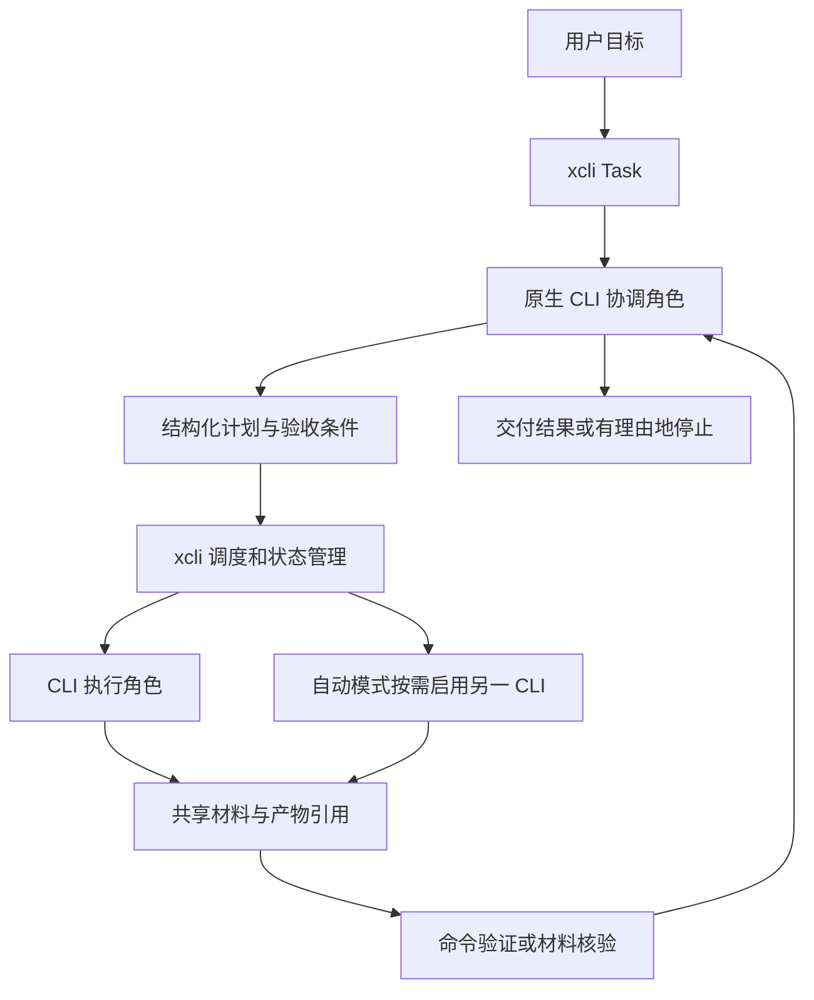

**xcli 产品调整方案：一个任务入口，支持指定单 CLI 与自动协作 · 2026-10-14**

2026-10-17 R3 启动检查：R2 技术前置条件已具备，可以进入对照实验、独立用户观察及发布准备；正式发布尚需补充证据，见 [R3 启动检查](r3-readiness.zh-CN.md)。

2026-10-17 R2 更新：后台、stop/continue、持久检查点、失活识别及 session/材料恢复已实现；Work/Project × 指定/自动真实路径通过。历史规划保留，下文状态以 [R2 实施与验收记录](../r2/results.zh-CN.md)为准；未打 tag 或发布。

2026-10-16 R1 实施更新：Task、两种执行方式、交接与旧管理入口收口已完成；Work/Project × 指定/自动四条真实路径已在 macOS arm64 的 Codex/Cursor 上验收通过，累计调用 52/60 次；以 [R1 说明](../r1/README.zh-CN.md)和[本批验收记录](../r1/results.zh-CN.md)为准。下文较早状态仅保留历史背景，R2 尚未实现。


2026-10-15 实施更新：R0 代码改造已落地，本地回归与四平台构建通过；Cursor 信任授权后运行通过，三个 CLI 图片生成与编辑均完成真实验收。Antigravity 视频和音乐研究按用户决定暂缓；其他未验证范围见 [R0 实施与验收记录](../r0/results.zh-CN.md)。尚未发布安装包。下文保留方案形成时的状态，下一阶段是 R1 Task 入口及两种执行方式，R1/R2 能力仍未实现。

本文是产品与实施建议，供本轮讨论和后续拆任务使用；新增命令、数据结构与能力均未实现。本次只调整文档，不改变现有 CLI 行为或发布承诺。依据为用户的[原始讨论](https://chatgpt.com/share/6a4667f0-8a90-83ea-b9a9-ce78d5ba66c7)、本轮明确的任务目标、当前源码与开发分支，以及本日读取的官方资料。

用户补充已纳入：非必要方向可以直接删除；用户可以指定一个 CLI 独立完成任务。后续不再默认保留所有已实现功能，也不要求每个任务都启动多个 CLI。下文的“删除”指从目标产品和实施路线中移除；已发布命令按退役步骤处理，本次不删除生产代码或用户配置。

**一、需要重新对齐的目标**

建议产品主张调整为：

> **一条命令交给 xcli，由你指定的 CLI 或自动安排的 CLI 团队持续推进，交付可检查的结果。**

用户只需提交目标，可以让 xcli 自动组织执行，也可以指定一个 CLI 独立完成。xcli 负责执行安排、必要的任务拆解与材料交接、失败处理、进度保存和结果汇总。任务可以是一次对话中的资料分析、方案写作和文件整理，也可以是项目中需要多轮实现、测试、修复的长任务。

原始讨论中，用户认可了统一安装、运行、切换和编排的入口；当时给出的安装、代理、会话、协议和统计功能是分阶段建议，不应全部变成同等优先的产品目标。本轮用户进一步明确了“一个命令执行任务，不同 CLI 根据能力配合完成”。这应成为后续设计的主线。

2026-09-08 的方案把日常单 Agent 管理放在中心，将跨 Agent 协作作为可选附加场景。新的调整是：**任务完成成为主路径，自动协作与显式单 CLI 是同一任务入口的两种执行模式。** 自动模式按任务需要分工；显式单 CLI 模式遵守用户选择，不因任务复杂就自动加人。用户无需手写 YAML 或逐个指定执行顺序。

| 产品决策 | 调整后要求 |
| --- | --- |
| 用户操作对象 | 任务目标、进度、结果和继续入口 |
| xcli 的责任 | 选择与分工、任务状态、材料交接、执行约束、失败处理、验收与恢复 |
| 原生 CLI 的责任 | 实际推理、检索、编辑、工具调用及自身的认证与原生能力 |
| 核心交付 | 一个自然语言任务按所选模式完成，结果可检查，长任务可继续 |
| 执行模式 | 默认自动组织；`--agent <name>` 将 xcli 安排的全部 Agent 执行锁定到指定 CLI |
| 默认交互 | 一条命令开始；已有授权范围内持续推进，只在缺少关键业务信息或必要权限时停下 |
| 差异化假设 | 跨工具交接与长期任务连续性能减少人工协调；需要实测，不能先宣称优于所有原生 Agent |

**二、当前发展方向对 xcli 的约束**

下表的“事实”来自本日读取的一手资料；“取舍”是本方案的产品判断。文档可用、命令存在和实际账号可运行分别记录，不互相替代。

| 已文档化的事实 | 对 xcli 的取舍 |
| --- | --- |
| Codex 与 Cursor 已支持子 Agent、独立上下文和结果汇总。参见 [OpenAI Subagents](https://learn.chatgpt.com/docs/agent-configuration/subagents)、[Cursor Subagents](https://cursor.com/docs/subagents)。 | 单纯“启动多个 Agent”不足以形成长期价值；聚焦不同 CLI 之间的任务责任、材料交接和统一恢复。 |
| Codex 提供 JSONL 非交互执行及有线程、轮次、事件和中断语义的 App Server。参见[非交互模式](https://learn.chatgpt.com/docs/non-interactive-mode)、[App Server](https://learn.chatgpt.com/docs/app-server)。 | 原生结构化入口优先；第一版先复用 headless 进程，有持续消息需求时再接适用的会话协议。 |
| Cursor CLI 的当前本地帮助包含 ask/plan、stream-json、worktree 与 persist；官方[参数文档](https://cursor.com/docs/cli/reference/parameters)列出运行控制。 | 将原生能力纳入适配与检测，不把“再做一套终端、worktree 或持久会话”单独当产品卖点。 |
| Antigravity 已有独立 CLI、print、结构化输出和会话继续入口；[headless 文档](https://www.antigravity.google/docs/cli/headless/)还描述了多轮流式输入。 | 必须单独实现 Antigravity Adapter；不能用 Gemini Adapter 代替，也不能把 IDE 中的全部工具能力直接推定给 CLI。 |
| Anthropic 的[长任务工程实践](https://www.anthropic.com/engineering/effective-harnesses-for-long-running-agents)强调明确的完成清单、增量推进、进度记录和测试。 | 长任务首先需要可持久化的目标、检查点和证据；单独保持一个进程存活不够。 |
| Anthropic 的[多 Agent 研究系统](https://www.anthropic.com/engineering/multi-agent-research-system)记录了并行研究的收益，也指出成本和协调限制。 | 按任务选择协作方式；独立探索可并行，共享写入先串行。收益必须与单 Agent 基线比较。 |
| Claude Code 的 [Agent teams](https://code.claude.com/docs/en/agent-teams)已有协作会话，但文档仍列出实验状态和恢复限制。 | 适配器逐项声明能力；不能因为厂商支持“团队”就承诺可统一恢复所有内部成员。 |
| [AWS Labs CAO](https://github.com/awslabs/cli-agent-orchestrator)已经提供跨原生 CLI 的 supervisor/worker 协作。 | 跨 CLI 编排已有同类。xcli 应验证“本地直接提交任务、少配置、材料与进度可追踪”的具体体验，不沿用原讨论中的市场空白或相似度百分比。 |

由此建议：xcli 作为本地任务运行时，复用原生 Agent 能力；先做单 CLI 和跨 CLI 两种执行方式，以及一套可靠任务生命周期。全量统一权限 UI、协议平台、管理控制台和远端集群从目标路线删除。

**三、Work 与 Project 使用同一个任务模型**

这里的 Work 指对话中交付一项工作，并不限定某个厂商的 Work 产品；Project 指有项目目录和持续修改需求的任务。xcli 不自动继承 ChatGPT Work、Cursor IDE 或 Antigravity IDE 的连接器、浏览器、桌面控制和后台服务。

| 维度 | Work：完成一项工作 | Project：推进一个项目任务 |
| --- | --- | --- |
| 示例 | 整理需求、比较方案、分析日志、生成有出处的报告 | 修复缺陷、实现功能、重构、迁移并通过指定测试 |
| 工作区 | 私有任务目录或用户指定目录，不强制 Git | 明确关联项目；需要改动时使用受管理的工作区 |
| 上下文 | 用户目标、对话摘要、输入文件、来源及决策 | 额外包含仓库基线、目录、改动、测试和依赖状态 |
| 执行组织 | 指定单 CLI 完成，或按需组织独立分析、整合与复核 | 指定单 CLI 推进，或分工探索、实现、审查与修复；验证由实际命令执行 |
| 验收 | 文件/报告存在、要求覆盖、引用可追溯；主观质量另行评价 | 验证命令、当前改动与审查证据关联；未验证项明确 |
| 长时间执行 | 可分段查证、产出中间稿、等待补充后继续 | 可跨多个执行轮次，保留检查点、失败证据和工作区 |

首版 Work 限定文本、文件和已验证的检索工具；Project 限定本地单仓库。任意桌面应用操作、跨仓库自动合并和外部发布不进入首版默认范围。

两类任务都使用相同的 Task、计划、角色、事件、产物和检查点。不要分别扩展成“办公 Agent 平台”和“编码工作流平台”。

从已有对话进入时，由用户或调用方显式传入目标和选定上下文；不自动读取其他产品的全部聊天历史。任务运行中收到的补充继续归入同一个 Task，形成目标/计划的新版本；原生入口不能实时接收消息时，先排队到检查点处理，并显示尚未应用，不能假装已经插入正在执行的轮次。

**四、用户看到的主路径**

新增一个任务入口。现有 run/use 可作为底层执行入口保留；workflow 的引擎复用，独立 YAML 产品入口逐步退役。以下全部为拟议接口：

```bash
# Work：一条命令提交目标
xcli task "比较这三份方案，形成建议文档，并让另一个 Agent 核对关键结论" \
  --input ./materials --output ./deliverables

# Project：同一入口，明确项目和完成条件
xcli task "修复缓存失效问题，运行项目测试，并由另一个 CLI 审查" \
  --project .

# 指定单 CLI：整个任务由 Codex 完成
xcli task "修复缓存失效问题并运行测试" --project . --agent codex

# Work 同样可以指定单 CLI
xcli task "根据这些材料形成方案文档" --input ./materials --agent cursor

# 长任务：提交后可以离开终端
xcli task "完成迁移清单中的剩余项目并逐项验证" --project . --detach

# 单 CLI 也支持后台长任务
xcli task "逐项完成迁移并验证" --project . --agent codex --detach

# 查看同一个任务、补充目标后继续、停止
xcli task status <task-id>
xcli task continue <task-id> "按刚才的结论继续，优先处理兼容问题"
xcli task stop <task-id>
```

| 执行模式 | 如何选择 | 确定行为 |
| --- | --- | --- |
| 自动组织 | 不传 `--agent` | 按可用能力与任务需要选择一个或多个 CLI；复杂协作有分工、交接和结果责任 |
| 指定单 CLI | `--agent codex` / `--agent cursor` / 其他已注册名称 | 协调、实现、修复和文本复核均使用所选 CLI；不调用其他 Agent CLI，也不自动切换到其他 CLI |

指定工具未安装、未登录、能力不足或额度不可用时，任务明确报告失败或等待处理；不能悄悄改用其他工具。确定性测试和普通命令可以继续使用，它们不属于第二个 Agent CLI。所选 CLI 的原生内部子 Agent 仍属于同一 CLI；xcli 的任务指令禁止自行转调其他 Agent CLI，严格的可执行文件限制需由已验证的原生执行策略支持。

单 CLI 和自动模式共享 Work/Project、状态、结果、后台、预算和检查点。`continue` 继承原任务的模式、指定 CLI 和登录入口约束，不能在恢复时自动扩充团队；用户明确改变策略时记录变更与必要交接。单 CLI 的自查标记为自查，不能包装为另一个 CLI 的独立审查。

首版围绕 task/start、status、continue、stop 四种行为组织；不再为 review、compare、debate、swarm 各造一套主命令。是否加入根命令简写 `xcli "目标"` 在主路径验证后决定。

开始后展示任务 ID、目标、工作区、初始分工和边界；执行中展示“谁正在做什么、最近实际活动、下一步”；结束时展示结果文件或 diff、验证情况、遗留项和继续入口。普通任务不要求用户选一个固定团队或理解 YAML。

示意输出：

```text
Task task-…：修复缓存失效
计划：探索 → 实现 → 测试 → 独立审查 → 必要时修复
执行：codex；审查：cursor；测试：项目指定命令
[实现] 已完成改动，等待验证
[验证] 1 项失败，正在交回实现角色
[审查] 已读取本轮 diff 和测试证据
结果：工作区路径、完整改动、测试记录、未解决项
```

以上 CLI 名称只是示例分配，不代表品牌能力排名。只有实际参与过执行和交接的 CLI 才出现在协作摘要中。

单 CLI 模式直接展示“执行方式：指定 Codex”，按需展示计划和验证，不强制为了填满角色而额外启动协调或审查轮次。

**五、协作机制：有主责、有交接、有结束条件**

建议采用“一个任务协调角色 + 按需执行角色 + 确定性运行时”的结构。协调角色由一个已接入、可用的原生 CLI 承担，负责理解、计划与综合；Go 运行时负责验证计划、分派、持久化、取消、预算与状态合成。首版不引入额外模型 API 作为必需依赖。

单 CLI 模式的协调与执行可复用同一个原生会话，按需分轮推进；运行时将候选 CLI 池限制为用户指定项。下面的跨 CLI 分支仅在自动模式选择协作时启用。



| 角色 | 责任 | 约束 |
| --- | --- | --- |
| Coordinator | 维护目标、拆解、指派、结合证据调整计划、给出最终交付 | 可以和一个执行角色复用同一 CLI；不得自行把缺证据结果标为验证通过 |
| Worker | 完成范围明确的子任务并交付文件、改动或分析材料 | 接收目标、输入、输出要求和实际 cwd；不自行扩展整个任务范围 |
| Reviewer | 针对指定版本的材料检查，给出可定位的问题 | 自动协作可使用另一 CLI；指定单 CLI 时由该 CLI 自查并标明，角色独立不等于模型或供应商必然独立 |
| Verifier | 执行测试、检查文件/格式/引用等可复核要求 | 能确定性检查的由程序或真实命令执行；主观评价单独保存 |

每个子任务至少定义 objective、输入引用、输出、所需能力、依赖、写入范围、超时和 acceptance。首版 Coordinator 输出结构化的下一批动作，由运行时校验后执行；先串行推进，允许少量互不依赖的只读工作并行。

允许的动作先控制为 delegate、verify、revise_plan、request_input、complete。模型提出命令不代表已经获准执行；argv、目录、依赖、预算及现有授权由运行时检查。计划调整保留版本、原因、输入变化和受影响节点，不悄悄覆盖旧结果。

不能把协作简化为“同一个提示词发给所有 CLI，再拼接回答”。有效协作需要不同责任、可追溯输入和后续消费：例如审查角色确实读取本轮实现产物，并将可复现问题交回实现角色。

**六、根据能力选 CLI，保留可解释的选择**

把执行对象拆成 CLI Adapter、模型选择、登录入口、工具能力和角色。两个 Codex 登录入口可以提供容量或环境选择，不能自动算作两个不同能力的 Agent；不同 CLI 也可能使用相同模型。

| 选择依据 | 首版要求 |
| --- | --- |
| 运行条件 | 已安装、命令版本、登录状态、最近真实执行结果；登录成功不代表额度充足 |
| 功能能力 | headless、结构化输出、持续输入、resume、cwd、取消、文件编辑和适用工具 |
| 权限与工作区 | 是否能满足只读/限定写入；原生 sandbox 与提示词约束分开标记 |
| 任务需求 | 需要哪些输入类型、检索工具、项目访问和输出形式 |
| 偏好与效果 | 用户已选工具/模型、明确角色偏好、固定任务集的实际表现 |
| 成本与时间 | 可观测用量、调用轮次、超时、可用并行度；未知价格不补成零 |

显式 `--agent` 是执行约束，优先于所有自动选择；候选池先收缩到该 CLI，再检查能力与可用性。自动模式才使用“明确偏好 + 硬能力过滤 + 简单评分/规则 + 可解释回退”。Coordinator 在符合模式、能力与授权的候选池中提出分工，运行时约束最终执行。不建立预测式智能路由平台，也不在代码中固化“某品牌永远负责前端/后端/检索”。

自动模式按任务需要决定参与数量；跨 CLI 协作的专门演示与验收必须包含至少两种真实 CLI，单 CLI 任务不受此要求影响。用户明确要求某种协作时，应按要求执行，或明确报告缺少可用参与者；不能静默变成单 CLI 后仍称完成协作。如果 `--agent` 与提示中的“使用另一个 CLI”冲突，先指出冲突，不擅自解除单 CLI 约束。

不自动修改其他 CLI 的长期规则、安装插件或同步 MCP 来凑齐能力。工具不够时报告缺口，使用已有明确可用的替代方案。原生 CLI 内部子 Agent 首版视为其执行细节；不能观测的内部调用和用量标为未知，不声称已限制整个递归执行树。

**七、材料交接与长任务连续性**

Task 是稳定的用户工作身份，Run 是一次 CLI 或命令执行，Session 是厂商原生会话；三者不能再混用。一个 Task 可关联多种 CLI、多个 Run、多个 Session 和多个计划版本。

| 持久化对象 | 必须保存的信息 |
| --- | --- |
| Task | 原始目标、用户补充、执行模式、指定 CLI/登录入口约束、验收条件、状态、工作区、预算与计划版本 |
| 子任务 / Attempt | 指派角色、CLI/模型/登录入口引用、输入摘要、实际 cwd、开始结束、原生与解析状态 |
| Handoff | 已确认事实、关键决策、来源、相关文件/diff、验证记录、未完成项和下一步 |
| Artifact | 路径或受控引用、类型、生成者、版本/内容摘要、被哪些步骤消费 |
| Checkpoint | 已完成节点、待运行节点、当前材料版本、工作区基线、可恢复 session 和失效条件 |
| Event | 单调序号、时间、task/run/step/attempt 关联及事件类型 |

交接采用任务简报、摘要和选定产物引用，避免把所有 CLI 的完整日志互相广播。新角色拿到完成自身工作必需的材料即可；事实、Agent 推断和待核实问题分别标记。后续需要更多上下文时按引用补取。

原 session 能在相同原生登录环境恢复时优先复用；不可恢复时从 Task 检查点新建原生 session，重新交接已确认材料。跨 CLI、跨账号迁移使用材料交接，不复制厂商私有 session，也不把 session ID 当通用工作 ID。

Task 功能需要保存目标、协作摘要和必要产物，属于新增的持久化边界，必须在使用说明和记录策略中明确。现有 run 的完整输出默认关闭保持不变；原始工具输出、任意日志和凭据不自动加入协作包。私有运行数据保存在用户数据目录，交付文件写到任务指定位置。

长任务分三个层级交付：

| 层级 | 产品承诺 | 阶段 |
| --- | --- | --- |
| 终端退出后继续 | 已启动的后台 worker 在本机继续；状态与材料持续写入 | 第一版完整协作场景 |
| 中断后继续 | stop、进程退出、上下文用尽后，用同一个 Task 从可信检查点推进 | 长任务里程碑 |
| 机器重启后继续 | 再次执行 continue 时重建状态、核查工作区并推进；不自动重放不明副作用 | 长任务里程碑；不承诺无人值守开机自启 |

建议 Task 状态为 planning、running、waiting_user、paused、needs_reconcile、completed、failed、canceled。正在执行的原生命令退出、用户暂停、等待关键输入和控制进程失联分别处理。已有 Job 的 orphaned 状态不直接替换成 Task 已失败或已完成。

先用本地单 owner、任务锁、追加事件和原子检查点保证可解释恢复，不引入常驻调度集群。控制进程失联后先检查锁和所有权，不能只按 PID 操作；恢复时重新确认工作区和产物。重启时状态不明的写入/外部操作进入 needs_reconcile，不盲目重跑。首版暂停可以终止当前 attempt 并保留检查点，不承诺所有 CLI 都支持原地冻结或实时插话。

**八、完成标准：任务结果、验证与用户接收分别表达**

执行成功、验证通过和用户接收分别记录。Coordinator 的“已经完成”是一份待核对声明，运行时根据预先确定的验收条件和产物证据判定 Task 是否满足完成条件。

| 场景 | 首版完成条件 | 不能据此宣称的结果 |
| --- | --- | --- |
| 方案/研究 Work | 指定文件存在；要求覆盖；来源可访问或明确缺失；要求复核时有记录并注明自查或跨 CLI 审查 | 不把格式检查通过等同事实全部正确或用户认可 |
| 本地文件处理 Work | 输出清单、格式/内容不变量、输入输出关联及未处理项可检查 | 不把 Agent 自述等同已经生成文件 |
| Project | 完整 diff 与未跟踪文件可见；声明的验证实际执行；对应材料版本一致；审查遗留项明确 | 不把原生退出 0、历史测试或文本“通过”当成当前测试证据 |
| 长任务 | 各检查点、完成/未完成节点和停止原因可追溯；继续后不遗漏或重复已确认工作 | 不把后台进程仍存活等同任务在有效推进 |

首版失败修复有界：一次实现/产出 → 验证或审查 → 必要时一次修复 → 再验。超过修复次数、总时限或调用上限时交付当前材料和停止原因。允许后续用户继续同一 Task，不能通过不断创建新 Run 绕开 Task 总预算。

Project 首版默认一个可写角色；只读分析可并行。需要同时写入时使用不同工作区，合并成为独立受控步骤。共享 worktree 不提供文件级隔离，Git worktree 也不是操作系统沙箱。审查输入绑定不可变快照或明确的内容摘要，避免审查过程中写入变化污染结论。

**九、现有能力如何收敛**

当前 main 为 0a880f9，产品实现与 v0.4.0 一致；开发快照 origin/v.0.5.0 为 6d59f7f。阶段 0 已完成，七项缺陷仍需修复；本轮前序审查的 13 个适用分支案例均复现。

| 现有/拟议能力 | 调整决定 | 后续投入方式 |
| --- | --- | --- |
| Task、指定单 CLI、自动协作、验收、检查点 | 核心保留 | 两种模式共享任务生命周期；跨 CLI 模式增加角色交接 |
| 真实 CLI 进程、环境/网络、argv、取消、私有记录 | 保留并复用 | 作为执行底座，避免整体重写 |
| run/use 与原生 resume | 保留为底层入口 | 原生透传和排障使用；完整单 CLI 任务统一走 task --agent |
| DAG、超时、重试、变量/产物引用 | 合并为内部执行能力 | 服务 Task 计划与有限修复，不再单独扩张 YAML 工作流产品 |
| 后台 jobs、runs 查询与日志 | 合并到 Task 生命周期 | 复用 worker/锁/停止/存储；Task 完整接管后收掉重复主入口，历史记录仍可回查 |
| worktree、command、plan 开发线实现 | 按模块接入 | 服务 Project 的工作区、真实验证和可解释执行 |
| Agent 发现、只读登录/能力检测、任务偏好 | 保留最小必要能力 | 直接使用已有 CLI；选择来自任务参数和必要配置，不再扩张安装管理中心 |
| Task 用量、调用次数和时限 | 保留必要观测 | 用于执行预算、停止条件和对照实验；未知值明确标记 |
| Gemini/OpenCode | 保留既有兼容 | 新里程碑优先接入用户实际可用的 Cursor/Antigravity/Codex；新增测试环境按需补齐 |
| Claude Code | 保留 Adapter，按环境补验 | 缺账号/CLI 时标记未验证，不阻塞其他 CLI 的首个协作场景 |

下列方向直接从目标产品和实施路线删除，不作为默认“以后再做”的积压项：

| 删除/退役方向 | 具体处理 | 任务需要的能力如何满足 |
| --- | --- | --- |
| 统一 MCP import/sync/ownership 管理 | 退役跨厂商配置写入、导入、ownership 迁移平台；取消新增 ownership v3 全套建设 | 原生 CLI 沿用自己的 MCP 和工具配置；xcli 只检测任务所需能力是否可用 |
| 面向外部客户端的 ACP stdio 代理入口 | 退役独立 xcli acp 产品入口及扩展路线 | 首版使用已验证的原生结构化进程；未来若某 Adapter 必须使用协议，只作为内部实现单独评估 |
| CLI 安装、登录包装与独立默认切换命令 | 退役 install/auth login/default 等管理入口的扩展与目标产品地位 | 给出原生安装/登录指引，保留发现和诊断；task --agent 显式选择，自动模式使用任务偏好 |
| 正则提示词路由产品 | 退役 route 与独立规则管理，不迁入 Task | Task 的模式约束、能力过滤和必要角色选择已覆盖需求 |
| 独立 YAML 工作流产品入口 | 退役面向用户的 workflow validate/plan/run 及模板平台扩张 | 引擎、计划检查、DAG 和确定性 command 作为 Task 内部能力复用；旧文件用户按迁移说明继续使用旧版本或转为任务目标 |
| 独立统计/统一账单产品 | 退役独立 usage 看板与高级统计路线 | Task 结果保留已观测用量与执行上限 |
| 全量 TUI/Web 控制台、远端集群、通用插件 SDK | 从路线删除 | 首版用 CLI 状态、事件和文件交付；Adapter 按实际目标工具维护 |
| 通用 PTY 屏幕自动操控与全量统一权限 UI | 从路线删除 | 使用原生结构化入口和已验证的权限策略；不可结构化驱动的工具不进入自动任务候选 |
| review/compare/debate/swarm 平行主命令、固定品牌团队 | 从路线删除 | 任务目标表达意图，自动模式按需安排角色，指定模式遵守单 CLI 选择 |
| 无限自循环、静默多账号轮换 | 从路线删除 | 有界修复、明确停止条件，账号入口由已授权配置显式选择 |

删除现有入口按一份明确的退役清单执行：标明最后支持版本、替代路径和退出版本；退役版本不与公共修复补丁混淆。过渡版必要保护仍要交付，不让当前用户继续遇到已知配置丢失或错误成功。

MCP 尤其需要处理旧原生配置对 xcli mcp serve launcher 的依赖：先提供迁移说明，过渡版保留所需 launcher；原生配置切换到有效入口前不能直接移除它。对无法证明安全的 sync/import 更新、删除先保守拒绝；不再为全面支持新的同步能力扩建平台。用户的原生文件、源配置、ownership 和历史运行数据不随功能退役自动删除。撤下产品能力与销毁用户数据是两项不同操作。

已删除方向只在未来出现明确任务需求、收益和范围时重新立项，不自动恢复到路线。继续保留的底层代码必须能指向 Task 主流程或必要过渡；没有用途的代码在实施退役时一并清理。

**十、实现落点与旧路线的取舍**

建议在现有执行底座上增加薄 Task 层，不将 Coordinator 生成的内容直接作为任意 YAML 或 shell 执行。

| 模块 | 主要改动 | 复用位置 |
| --- | --- | --- |
| Agent Adapter | 补 Cursor/Antigravity；分适配器增量解析、能力声明、会话与错误映射 | internal/agent、internal/runtime |
| Task 模型与存储 | task/run/session 关联，计划版本、attempt、交接、产物和检查点 | 新增 internal/task；引用现有 runstore，旧记录可继续读 |
| 执行模式与协作控制 | --agent 单 CLI 约束、自动模式、Coordinator 结构化动作、角色选择、计划校验、有限修复、预算与完成判定 | 在现有 workflow 调度能力上增量构建，避免复制一套进程引擎 |
| 工作区与验证 | 实际步骤 cwd、worktree 生命周期、argv 验证、当前内容与证据关联 | 开发线 internal/worktree、command/plan，先修 F01/F04/F05 |
| 用户入口 | task、status、continue、stop；流式活动、结果与遗留项摘要 | cmd 新入口，复用 jobs 和记录查询 |

旧任务 ID 用于历史追溯，继续、缩减、替代和取消分别标记；不将 26 项剩余工作全部作为新核心上线的前置条件。原文中已经验收的事实保留，被删除方向对应的未来实施要求不再作为新路线门槛。

| 旧任务 | 处理决定 |
| --- | --- |
| A01–A03 | 已完成，保留历史证据；补单 CLI/自动模式与 Task 契约；原 ownership v3 建设目标随 MCP 产品退役取消 |
| B01/B02：MCP 保护 | 缩减为过渡期配置保护、拒绝不安全写入和 launcher 迁移；取消通用四厂商同步平台扩建；已发布用户保护不得跳过 |
| B03–B05、B07 | 恢复目录、解析真实性、仍存在的示例/诊断问题和发布检查继续优先；移除入口后的专属测试随功能一起清理 |
| B06 | 所有 Project worktree 演示前必须完成 |
| C01–C04 | 围绕 task 两种模式的首次运行、增量事件、ID 和摘要交付；取消安装/默认工具管理向导与旧 default 更新需求 |
| C05、C06 | Task continue、正确 cwd、异常/失活识别提前；标题、短 ID、全面缓存优化按需要后移 |
| C07 | 入门验收覆盖“一条命令自动组织”和“指定单 CLI”，保留独立用户观察 |
| D01–D03、D05、D07 | 成为 Project 协作核心，连同新增交接和 Task 存储做一个完整场景 |
| D04 | 提升为长任务主线，先检查点恢复，再做复杂的跨步骤缓存复用 |
| D06 | 改为一个任务入口下的 Work/Project 两类能力，不再先扩展多个平行产品入口 |
| E01、E04、E05 | 保留验证和发布门槛，按真正接入且有实测的 CLI/平台声明支持范围 |
| E02 | 保留 Task 可恢复状态及必要退役保护；取消 MCP 通用自动恢复平台和独立清理菜单建设 |
| E03 | 先本人和少量独立用户验证协作价值，再扩大到原计划 10–15 位用户观察 |

旧规划中的 v0.4.1 可继续作为公共修复版目标。v0.5.0 是否承载新的任务协作场景，应在首个真实场景完成后决定；不沿用旧开发分支名字推导发布完成度或新排期。

**十一、重新组织为四个可验收里程碑**

| 里程碑 | 交付范围 | 退出条件 |
| --- | --- | --- |
| R0：可靠底座与真实 CLI 接入 | 必要公共修复与退役保护；开发线目录保护；Cursor/Antigravity Adapter；增量事件和最小能力检测 | 保留路径的已知缺陷回归通过；旧 MCP 配置不因退役丢失或失效；可用 CLI 真实路径有版本与记录；缺账号不伪装通过 |
| R1：一个入口，两种执行方式 | Task 入口；显式单 CLI 约束；自动协作的协调/执行/复核；交接包、真实验证和结果摘要 | Work 与 Project 均覆盖两种模式；协作场景至少两种 CLI 真正参与；指定模式全程不调度其他 CLI；失败可进入一次修复 |
| R2：长任务可继续 | 两种模式的后台、事件/检查点、stop/continue、失活识别、session 不可用时材料恢复 | 跨终端、控制进程中断和模拟重启演练通过；执行模式和指定 CLI 不漂移；目标、产物、用量和失败记录不丢失 |
| R3：验证价值与收敛发布 | 单 Agent 对照、独立用户观察、安装、版本兼容和发布证据 | 至少一个预先定义场景展示协作收益；没有目录/配置/虚假成功问题；未测范围和已知限制明确 |

R0 可以分批发布公共修复，不必等待所有新 Task 功能。R1 先做纵向小场景，再扩充任务类型；R2 的复杂调度和自动恢复不能倒过来拖住第一个真实协作结果。暂不重新给出整轮工作日承诺，待 R0 核对新增 Adapter 与 Task 契约后拆分估算。

**十二、本地 CLI、账号与验收条件**

用户本轮明确允许使用本地 CLI 做测试验收。这项授权作为后续正常验收的前提，不再沿用阶段 0 已耗尽的两次调用预算作为永久限制。本轮编写方案只执行版本、帮助和只读登录检查，没有发起模型任务、登录/退出账号或切换凭据。

| 工具 | 本轮本地直接观察 | 账号/额度状态 | 验收安排 |
| --- | --- | --- | --- |
| Cursor CLI | cursor-agent/agent 可执行；版本 2026.10.14-0f9edde；有 print、stream-json、ask/plan、resume、sandbox、worktree、persist | status JSON 返回 isAuthenticated=false；可用额度未验证 | 优先补 Adapter；登录可用后执行真实路径；当前不能填“可真实调用” |
| Antigravity CLI | PATH 命令 agy，版本 1.3.5；print、stream-json、多轮输入、conversation、sandbox、mode 可见 | 未执行账号/额度验证；用户陈述待确认 | 作为单独 Adapter 接入，优先验证 headless 与事件结束条件 |
| Codex CLI | codex-cli 0.162.1；exec/json、resume、App Server、sandbox 可见 | 当前默认原生环境 login status 成功；额度未验证 | 优先真实验收入口，实际可调用性待最小 smoke；历史 0.153.4 的验证不能代替当前版本验收 |
| 第二个账号/登录入口 | 用户提到“两个账号”，尚未确认指哪两个工具或入口 | 未核对第二入口，不能登记为两个已验证 Codex 账号 | 确认现有原生入口后分别检测；不自动建账号、不复制 token |
| Claude Code | 当前 PATH 未找到 claude | 用户关于“尚无账号”的具体范围待确认 | 模拟回归继续；真实验证暂记未具备环境，不能阻塞可用工具协作 |

本地版本/help 与官方文档存在细节差异，例如本机 agy print-timeout 默认显示 0s，而读取的 headless 文档写五分钟。适配器应主动设置自己的超时，按固定本地版本实测，不依赖这个默认值。权限参数也逐 CLI 验证，不能把 force、auto、plan 或 sandbox 名称直接视为同一种约束。

账号选择用不含秘密的登录入口引用，真实凭据继续由原生工具保管。Codex 的配置 profile 不自动等同独立账号；要单独确认其认证来源与 session 可见性。首次真实执行只使用已确认可用的默认入口；账号失效时明确停止该执行或使用已授权、已验证的候选，不把静默换账号作为成功路径。

建议验收按以下顺序开展，每轮预先记录调用上限和实际用量；协调、执行、复核、总结等所有模型轮次都计入上限：

| 验收层 | 场景 | 证据与投入 |
| --- | --- | --- |
| 本地回归 | 单 CLI 锁定/禁止隐式回退、解析中断、cwd、跨 CLI 交接、条件修复、检查点、重复恢复、取消、工作区保护 | 隔离目录和模拟进程；检查实际进程指派与保存模式；不调用模型，覆盖状态不变量 |
| 原生 smoke | 已登录 CLI 的最小 headless、结构化终止、同 session 继续、取消 | 首轮建议最多 6 次模型轮次，每次 120 秒；失败不自动重复；未具备登录条件的项标未验证 |
| Work 小场景 | 固定材料形成文档，分别由指定单 CLI 完成、由另一 CLI 核查预置矛盾或遗漏 | 两种模式分别验收；记录自查/交接/发现/结果；每任务建议上限 6 次模型轮次、总计 10 分钟 |
| Project 小场景 | 临时项目修复可测试缺陷，覆盖指定单 CLI 与自动跨 CLI 审查，并预置一次失败后修复 | 检查实际 diff、测试退出码、材料版本、指派模式、原仓库无误写；每任务上限同上 |
| 长任务 | 两种模式均覆盖后台、stop、worker 中断和模拟机器重启后继续 | 检查模式继承；先模拟时间和进程故障，再安排一项总时限 30 分钟的真实任务；调用上限独立固定 |
| 对照试验 | 相同材料、初始状态和可比较预算下，单 CLI 与 xcli 协作分别运行 | 比较完成率、遗漏/可复现发现、人工交接次数、耗时和观测用量；标明样本小，不推出市场结论 |

真实验收的前置条件是账号已登录、必要权限可用以及本轮具体任务边界确定。用户已有测试授权范围内的正常调用直接执行；未提供的新账号凭据和未授权外部副作用不能由测试自行补齐。跨终端后台和机器重启恢复是两种不同验收，不能互相代替。

**十三、判断产品是否已经回到主线**

| 判断项 | 通过标准 |
| --- | --- |
| 一条命令 | 用户提交目标即可开始，无需先手写工作流或手工准备 Agent 团队 |
| 指定单 CLI | --agent 约束所有 xcli 指派；失败不隐式换工具；Work/Project、后台与继续功能完整可用 |
| 真正协作 | 选择跨 CLI 协作时，至少两种 CLI 承担不同责任，有明确材料交接，后续步骤确实消费前序结果 |
| 能力匹配 | 每次选择有可解释依据；缺工具或账号时诚实报告，不按品牌假定能力 |
| 任务连续性 | 同一 Task 可跨多次 CLI 调用和中断继续，恢复到正确目录与材料版本 |
| 结果可信 | 交付文件/diff、确定性验证、主观评价与用户接收区分；失败不报成功 |
| 投入有价值 | 至少一个事先定义的场景减少人工协调、发现可复现遗漏或在中断后有效续跑；同时记录额外成本 |
| 产品保持收敛 | 新功能能说明服务上述哪一步；没有必要性的方向从路线删除，已实现的安排退役和代码清理 |

如果对照没有显示“多方同时编码”的收益，就收缩并行写入，保留跨 CLI 的执行—复核—交接；如果某类任务由单个 CLI 更好完成，调度选择单个 CLI。协作价值通过完成任务体现，不通过参与数量体现。

首个演示覆盖同一个入口下的两种选择：**让 xcli 自动组织一次真实协作，或指定一个 CLI 独立完成任务；两种方式都能查看结果并从同一个 Task 正确继续。** Work 与 Project 使用相同机制。代理、工具可用性和用量只在执行需要时出现；被删除的安装管理、统一 MCP、ACP 和独立 YAML 产品入口不再进入新主路径。

本方案的旧任务依据见[原阶段计划](phased-roadmap.zh-CN.md)、[原优化方案](optimization-proposal.zh-CN.md)及[阶段 0 验收记录](../phase0/results.zh-CN.md)。这些文档的已完成事实继续保留，新 Task 路线的实施与验收单独登记。
