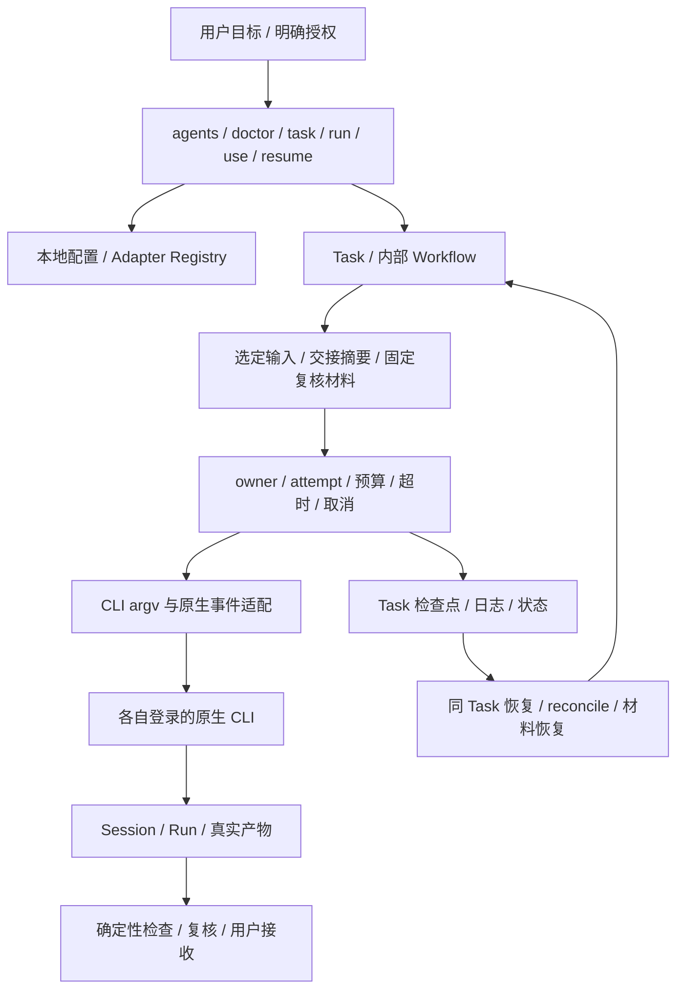

# R4 架构

## 核心执行路径

| 核心模块 | 源码 | 约束 |
| --- | --- | --- |
| Discovery / Doctor | `cmd/agents_doctor.go`、`internal/agent/probe.go` | 仅版本/help，能力来源可为 declared/help/unknown，不探取凭据。 |
| Adapter | `internal/agent`、`cmd/run_use.go`、`cmd/resume.go` | 配置 command/argv，结构化解析、原生 Session；保留其他 Adapter。 |
| Orchestrator | `internal/task`、`internal/workflow` | 有界串行阶段、跨 Adapter 复核、固定材料和一次修复；旧 workflow worker 保留。 |
| Session / Run / Jobs | `internal/runstore`、`internal/jobs`、`cmd/runs.go` | Task ID、Run ID、原生 Session 分离，不跨 CLI 搬运 Session。 |
| Supervision | `internal/runtime`、`cmd/task_process.go`、`cmd/task.go`、`internal/task/lifecycle.go` | OS owner 锁、attempt 监督、进程组、累计预算、停止与失活状态。 |
| Artifact / result | `internal/task/material*`、`review_material.go`、`integrity.go`、`internal/worktree` | 真实字节/摘要、版本与来源、当前验证；不自动合并或发布。 |
| Config / audit | `internal/config`、task/runstore/journal | 私有数据、配置兼容、必要诊断、无供应商 Token 管理。 |

原生 CLI 与厂商保持其自身认证和模型连接。xcli 不插入 HTTP 模型出口或中央凭据层。原生配置中用户已选择的工具依旧由原生 CLI 管理；xcli 不代其放宽权限。

## 运行边界

Task 的 `--agent` 锁定全部角色；自动模式从已安装结构化候选选择计划角色，不在失败后绕过原绑定换账号/工具。单 Task 默认 6 次进程调用、10 分钟累计执行、单次 120 秒；内部模型调用数不完全可见。

Work 只带选定材料进入工作目录；Project 从干净已提交仓库建 worktree。二者都是材料/工作目录约束，不是通用 sandbox。验证命令执行受信项目代码，复核绑定固定副本与内容摘要。

持续状态包括 checkpoint、owner/attempt、pending updates 与事件。未知副作用进入 needs_reconcile，不自动重放；Session 明确失效可从同 CLI/角色的材料恢复，认证/额度失败不触发回退。

图片等二进制文件可以保留与散列，当前 Task 不是通用媒体语义验收引擎。未来可复用安全 FD 导入、MIME/解码和文件来源组件扩展产物验收，无需模型 API 服务。

## 冻结层与构建耦合

`cmd` 仍链接 Model/NAG 命令实现，但隐藏其主帮助入口，用 `cmd/experimental.go` 默认阻断所有非保留检查/收尾操作。保留的查询/停止/撤销/disable 不需要打开服务。显式实验 opt-in 仅兼容旧工程回归，不赋予真实 Profile、供应商权限或 SIWC。

NAG 共享 `modelstore` 私有文件/锁工具及 `media`；`x/sys` 也供核心 Windows 进程/锁使用。物理拆分需先抽取中性存储/文件库、定义状态兼容与停止/回退方案。本轮不改用户状态 schema、不删除目录、不在运行时迁移服务。

CI 的核心包列表覆盖 root/cmd/agent/config/jobs/mcp/runstore/runtime/task/workflow/worktree/phase0；cmd 中三个历史 Gateway 客户端功能测试单列到完整回归，新默认关闭/兼容性测试仍在核心门禁。源码构建仍须能编译保留包；这不是 Gateway 功能/资格就绪门禁。
