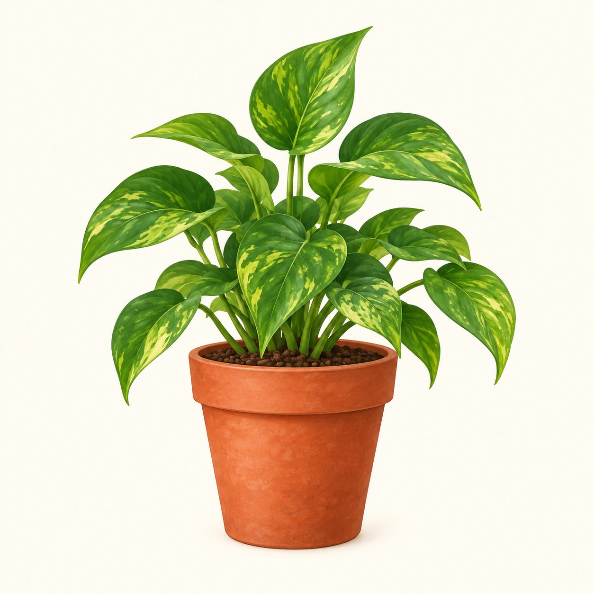
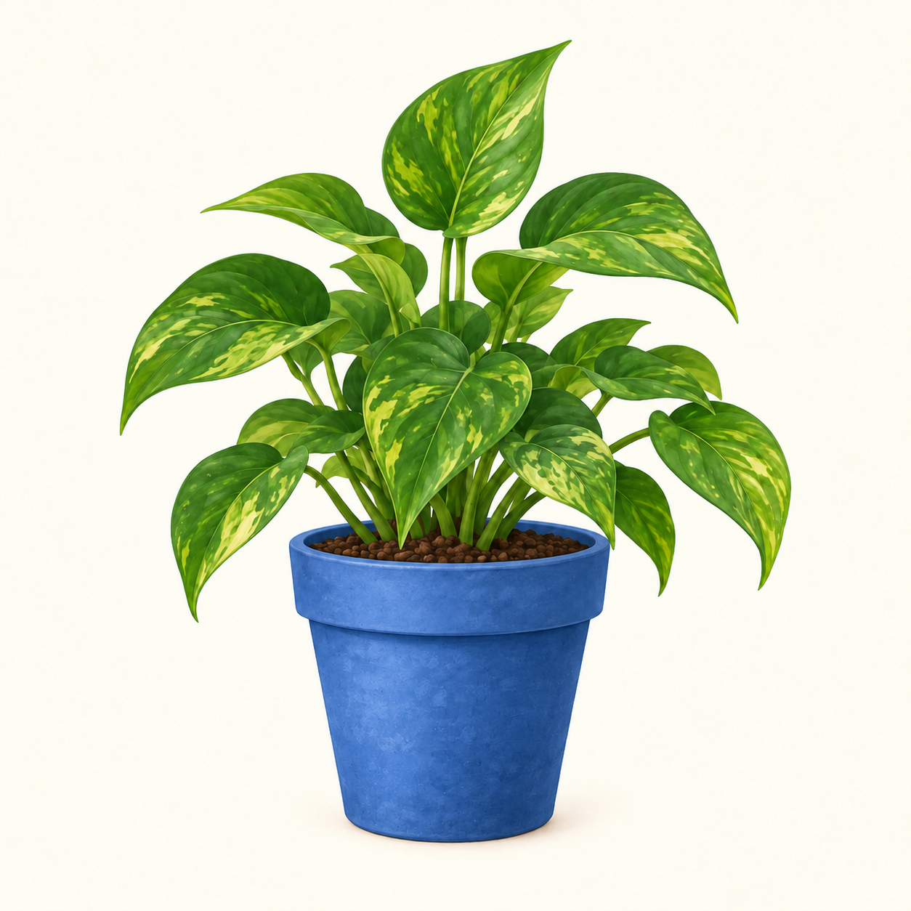
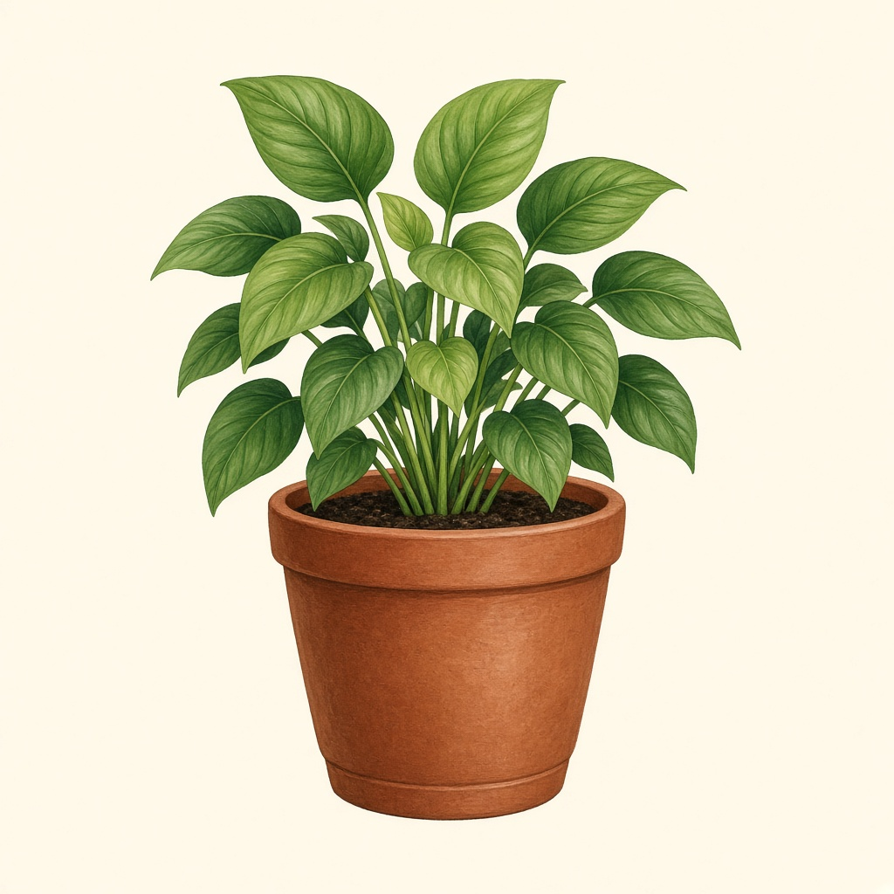
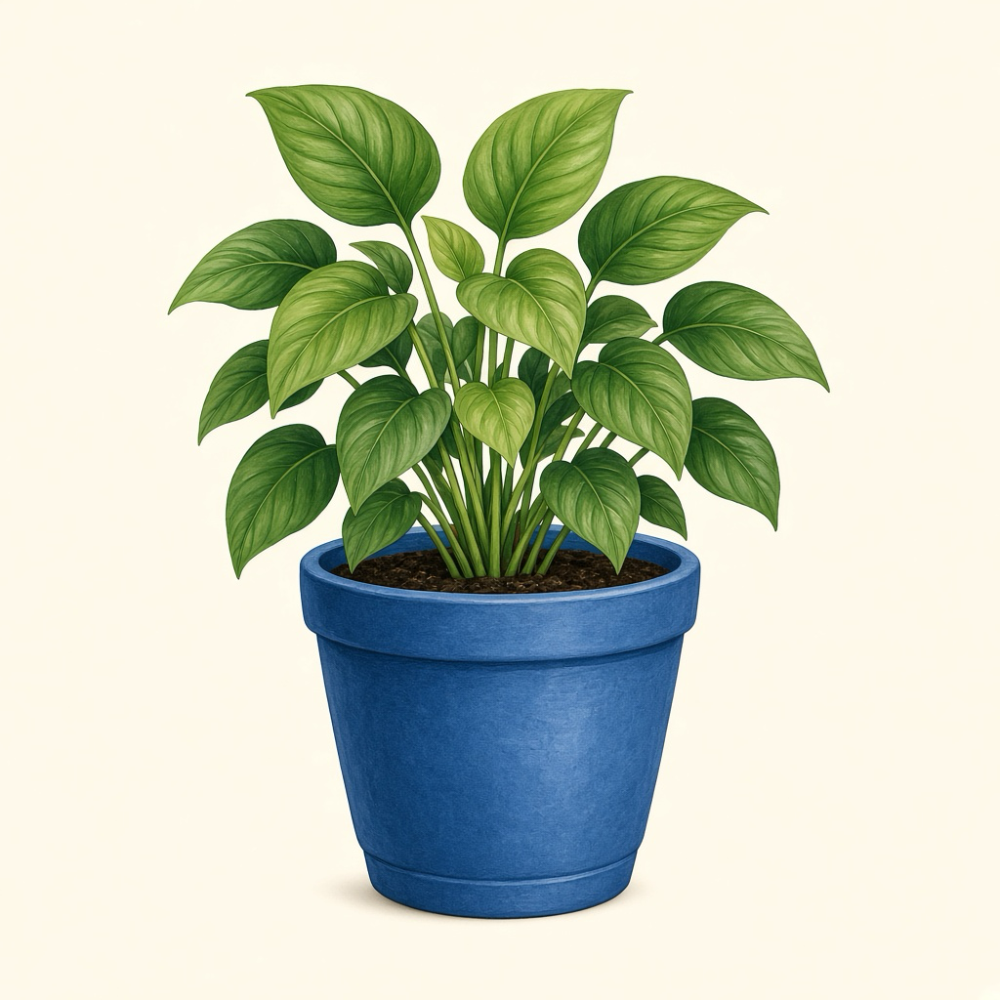
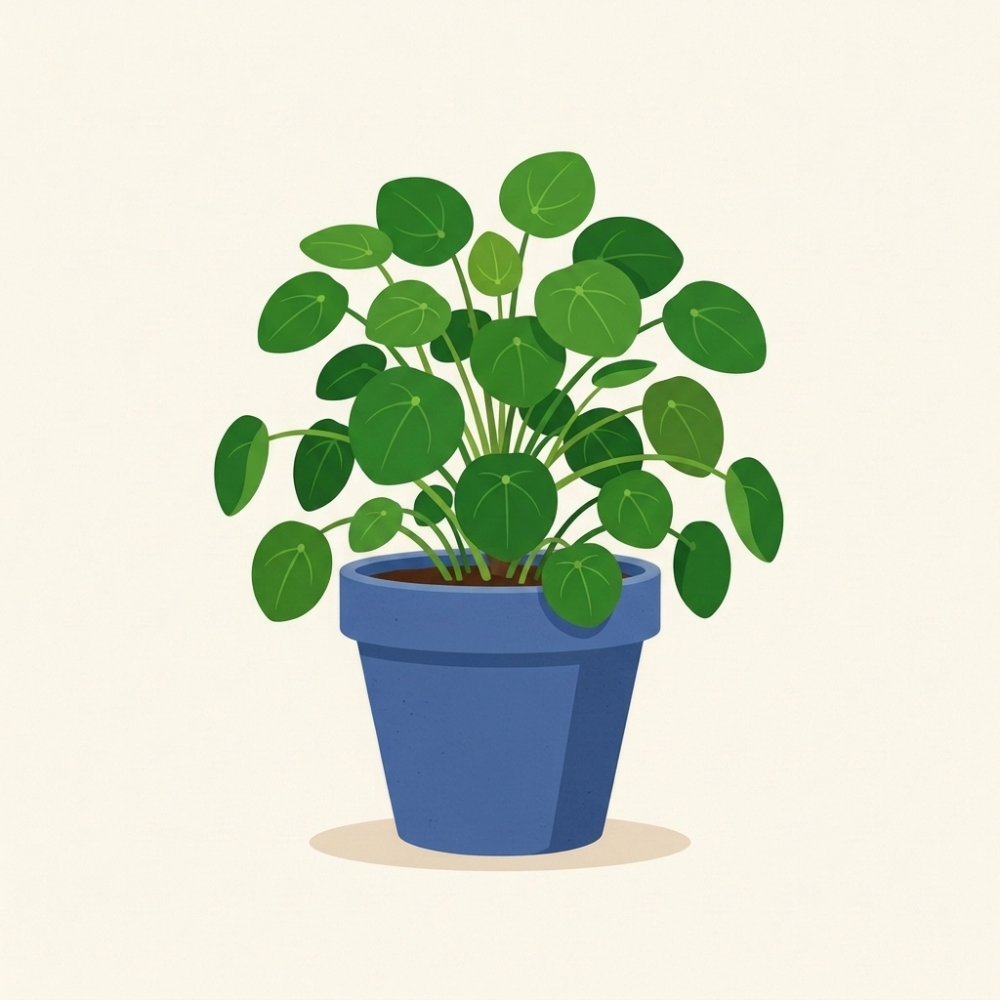
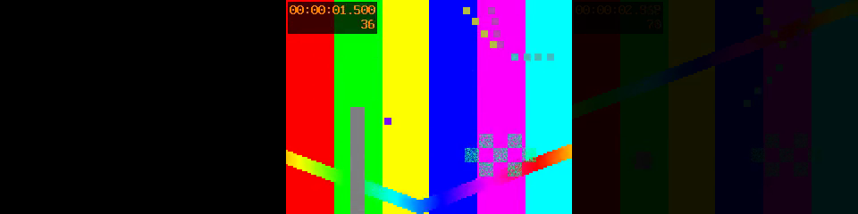

# 媒体能力真实验收 · 2026-10-15

本轮通过本机源码构建的 xcli 实际调用原生 Codex、Cursor、Antigravity，检查产物并保存证据。**三个 CLI 的图片生成与编辑均已产出有效文件；Antigravity 基础视频和音频编辑通过，视频和音乐的模型生成缺少可用原生接口。** 用户随后查阅资料并明确决定：Google Pro 订阅下的 Antigravity CLI 视频、音乐能力暂不继续研究，也不作为本阶段交付阻碍。 用户明确接受工具实际输出格式，Cursor 原生 JPEG 生图判定为通过；原先 PNG 转换被拒仍作为历史操作记录保留。

这里的“通过”指本次具体任务，不等于所有尺寸、模型、账号或媒体操作均兼容。证据见 [media-acceptance-20261015.json](evidence/media-acceptance-20261015.json)，原始私有日志位于 `/var/folders/tc/48w0b8390_q9xhrvc2v_mv580000gn/T/xcli-media-acceptance-20261015-w7ystxt2/`。未修改 chat-insight 项目，未发布任何产物。

## 验收环境与方法

- Codex CLI 0.162.1，使用用户已体验过的 `/Users/cengjiada/.codex-plus-gardenqaq@gmail.com`；开启的 image_generation 功能与原生会话中的 image_gen 调用均已核对。通过原生内置工具生成，不使用 API Key 脚本。
- Cursor CLI 2026.10.14-0f9edde，使用已有原生登录环境；传入 --trust 和 --auto-review，没有 --force、--yolo 或 --approve-mcps。
- Antigravity 采用已有原生账号、默认模型和当前工具。主模型配置与可用工具依会话而定；不从工具清单推断所有模型均能调用这些工具。
- 独立临时项目、显式 xcli recording.output=true，记录 stdout/stderr 及原生事件；全局 xcli 配置不变。图像编辑使用对应生成原图，Antigravity 图片编辑在未生成成功时改用明确标记的程序测试夹具。
- 视频和音频生成禁止用程序动画或正弦波代替模型；基础编辑使用程序测试视频和旋律夹具，允许已安装的 FFmpeg。它们只能证明剪辑链路。

初始 10 个场景各执行一次。另外保留 4 次定向探查：Antigravity 直接图片工具提示一次，--agent 选择 image-generator、video-generator、music-generator 各一次。共 **14 次 headless 原生进程启动**，无自动重试；后面三次立即因未知 Agent 失败。原生内部模型、工具往返次数未完整观测，不能把进程数当成模型请求数。只使用已有账号额度，未启用额外付费额度、安装服务、复制凭据或切换账号。

用户授权后追加 4 次 Antigravity 生成/编辑调用，以及 1 次恢复原会话完成交付，共累计 **19 次 headless 启动**。其中图片生成与编辑各实际调用 image-generator 一次，子代理调用 generate_image 的原生日志已核对；恢复交付只调用 run_command，没有重复生图。另有一次真实旧日志的离线回放，不计模型调用。

## 十个场景结果

| 场景 | 结果 | 耗时 | 产物或阻断原因 |
| --- | --- | --- | --- |
| Codex 图片生成 | 通过，尺寸选择受限 | 60.309 秒 | PNG，1254×1254；没有返回首选的 512×512，工具无尺寸参数 |
| Codex 图片编辑 | 通过 | 64.738 秒 | PNG，1254×1254；花盆改蓝，主体和背景基本保留，输入未覆盖 |
| Cursor 图片生成 | 通过，接受原生格式 | 60.733 秒 | 原生 JPEG，1024×1024，可打开；用户不要求PNG，历史转换被拒不影响本次生图能力判定 |
| Cursor 图片编辑 | 通过 | 51.059 秒 | 参考原图生成 JPEG，再成功转换为目标 PNG，1024×1024；输入未覆盖 |
| Antigravity 图片生成 | 授权后通过 | 111.151 秒 | 原生 image-generator → generate_image，JPEG 1024×1024；首轮受阻记录保留 |
| Antigravity 图片编辑 | 授权后通过，交付已恢复 | 92.357 秒 + 22.739 秒交付恢复 | 原生 JPEG 1024×1024，花盆改蓝、输入保留；首次复制被拒，精确授权后恢复同一会话完成复制 |
| Antigravity 视频生成 | 暂缓（用户决定） | 授权后 27.947 秒 | 实际 invoke_subagent 返回 video-generator not found or not allowed；无视频生成产物 |
| Antigravity 视频编辑 | 基础剪辑通过 | 27.864 秒 | FFmpeg 生成 3 秒 MP4，首尾各 0.5 秒淡入淡出，输入未覆盖 |
| Antigravity 音乐生成 | 暂缓（用户决定） | 授权后 24.254 秒 | 当前会话没有音乐生成工具或对应子代理；无音乐生成产物 |
| Antigravity 音乐编辑 | 基础剪辑通过 | 22.287 秒 | FFmpeg 生成 5 秒 WAV，末尾 1 秒淡出，输入未覆盖 |

“受阻”描述当前环境和本轮调用路径，没有证明 Antigravity 产品整体不支持这些媒体能力。图片复测和图片编辑返回了含 BLOCKED 的文本，但原生与 xcli 均退出 0、记录为 success；这表示该轮对话完整结束，**不是媒体任务完成**。本轮按实际文件判定受阻，没有把 completed 当作产物验收通过。

## 产物检查与预览

### Codex 图片

实际原生会话确认调用了内置 image_gen；生成和编辑各一次。PNG 签名、解码、尺寸与 SHA-256 均已检查，编辑输入的哈希未变。视觉检查确认花盆从陶土色改为蓝色，植物与米白色背景基本保留；上方 55% 画面的归一化平均像素差约为 0.0106，不能据此声称逐像素不变。

| 原图 | 编辑后 |
| --- | --- |
|  |  |

### Cursor 图片

原生事件确认调用 GenerateImage，编辑参数含本地参考图。首轮生成的真实格式是 JPEG，不能因为请求 filename=generated.png 就记为 PNG。生成阶段的转换命令较复杂，包含变量、命令替换和命令链，遭原生自动审查拒绝，拒绝结果未提供具体理由；本轮没有为该拒绝自动添加强制放行参数。

后续独立的编辑场景成功调用同一图片工具并完成 PNG 转换。用户随后明确“生成什么就是什么”，因此生图按真实可打开的 JPEG 判为通过；不再把可选的 PNG 转换作为生图通过条件，也不改写历史原生执行日志。视觉检查确认花盆改为蓝色，植物与构图基本保留；上方 55% 画面的归一化平均像素差约为 0.0203。编辑输入哈希未变。

| 原生 JPEG | 编辑后的 PNG |
| --- | --- |
|  |  |

### Antigravity 图片：授权后完成

用户明确授权媒体子代理后，主 Agent 通过 invoke_subagent 成功启动内置 image-generator。该子代理的真实日志记录了 generate_image 调用；它与 --agent 选取自定义主 Agent 是两个不同入口，前轮 unknown agent 不代表内置子代理不存在。

生成和编辑均得到真实 JPEG，1024×1024。编辑使用本轮生成原图，原图哈希未变，视觉检查确认花盆改为蓝色，植物与背景基本保留；上方 55% 画面的归一化平均像素差约 0.0081。

| 原生生成图 | 原生编辑图 |
| --- | --- |
|  |  |

编辑后主 Agent 曾尝试复制文件并把 JPEG 直接命名为 .png，命令遭拒，最后的原生 response 停留在“正在等待”。原生 result 同时包含 status=SUCCESS、非空 response 和 denied_actions。没有把 JPEG 改后缀当作格式转换。

本次修复了 xcli 对**非空 denied_actions**的判定：保留原生退出 0、parse_status=complete、已有回答和会话用量，但返回 failed/process_failed 与 xcli 退出 1。真实旧日志离线回放已确认该结果。随后临时放行从已知原生文件到验收 outputs/edited.jpg 的单条精确 /bin/cp 命令，恢复原会话完成交付；复制件与原生产物 SHA-256 相同，最终回答包含实际路径，没有重新调用图像模型。临时复制规则已移除。

可复用的生成示例（保留原生格式，直接返回原生产物路径）：

```bash
"$XCLI_BIN" run --agent antigravity --cwd "$XCLI_PROJECT" \
  "请调用内置 image-generator 子代理，生成一张米白背景、绿色植物和陶土花盆的方形插画，无文字，只生成1张。保留原生文件格式，不转换、不复制；等待完成后返回实际文件绝对路径。"
```

编辑时同样明确调用 image-generator，提供可访问的原图绝对路径，说明“只把花盆改蓝、保留其余内容、不覆盖原图、返回原生产物路径”。不要用 --agent image-generator 选择主 Agent。

### Antigravity 视频与音频基础编辑

[查看视频产物](artifacts/media-20261015/antigravity-video-edited.mp4)，[查看音频产物](artifacts/media-20261015/antigravity-music-edited.wav)。原始测试素材是 FFmpeg 测试图视频和程序构造的旋律，不是模型生成素材。

视频完整解码通过，时长 3 秒、320×240、H.264；采样帧平均灰度在 0 秒为 0，1.5 秒为 123.88，2.95 秒为 10.49，符合首尾淡入淡出的预期。下面依次为首帧、中间帧、末帧：



音频为 5 秒、44.1 kHz、单声道 PCM WAV。前 4 秒采样与输入一致，末尾 0.25 秒 RMS 为 0.008384，明显低于 3–4 秒的 0.096918，支持末尾淡出的结论。检查覆盖格式、采样与淡出效果，没有证明音乐模型生成、旋律改编或乐器替换能力。

## Antigravity 的能力边界与暂缓决定

首轮初始化事件的工具清单包括 generate_image，但模型报告没有可调用的直接图片工具。授权后的真实调用确认该模型可以通过内置 image-generator 子代理完成生成和编辑，图片阻碍已解除。清单中没有直接的 generate_video 或 generate_music，不能把图片通过推导为视频和音乐也可用。

为尝试无需子代理的入口，分别传入 --agent image-generator、--agent video-generator、--agent music-generator；三次均返回 `unknown agent ... (no custom agents are available)`，约 1 秒退出。--agent 选择自定义主 Agent，不能据此推断可以选择模型所述的内置媒体子代理。

用户授权后实际调用 video-generator，原生父会话 transcript 返回 `subagent "video-generator" not found or not allowed to be invoked`；音乐会话报告没有音乐生成接口，没有生成任何音频。两项已超出本轮命令授权阻碍，不能通过增加 allow 规则创建不存在或未开放的生成接口，也不能由程序合成替代模型结果。

官方 [Antigravity 工具参考](https://www.antigravity.google/docs/sdk/tools/)列有图像生成工具，视频和音乐可另外通过 [Gemini 视频 API](https://ai.google.dev/gemini-api/docs/video)、[Lyria 音乐 API](https://ai.google.dev/gemini-api/docs/music-generation)等服务接入；这些 API 的存在不能证明当前 Antigravity 原生账号已拥有对应 CLI 工具。本轮未接入、调用或购买这些外部服务。此前曾询问已有服务或配置入口；用户现已明确暂缓视频和音乐研究，本阶段不再请求凭据或推进外部服务接入。

用户要求继续后，进一步只读执行 `agy mcp list`，原生输出为 `No MCP servers configured.`。当前执行环境也没有 Gemini、Google、Vertex、Veo、Lyria、Suno、Higgsfield、Replicate、FAL 等相关生成服务的密钥/配置变量入口；仅检查变量是否存在，没有读取或输出密钥。该检查不能排除机器其他位置存在配置，仅保留为历史排查证据。根据用户最新决定，不再继续追查视频、音乐服务或配置。

另使用插件管理技能检索了可用媒体连接，发现 Higgsfield、HeyGen 等候选均未连接；助手侧插件目录也不代表 Antigravity 已配置相同服务，故未将其当作本次 CLI 验收成功或自动安装。

基础编辑所需的两条 FFmpeg 命令以完整固定参数、输入输出路径进行临时授权，原配置已备份。完成后已移除本轮新增的两条规则，保留先前 cat、ls、pwd、head 授权及其他设置；没有留下通用 FFmpeg、任意 shell 或 command(*) 授权。

## 对 xcli 的体验结论

图片请求和本地图片路径可以通过当前 run 的提示词/原生参数传递。Codex 使用 --image 附加编辑输入，Cursor 的工具参数也包含原图路径；文本最终回答能够包含可打开的产物路径。

以下缺口仍需分别处理：

- 媒体产物格式、目标路径和真实存在性缺少统一验收。当前 xcli 的 success 是执行结果，不是对用户媒体目标的验证。
- 原生工具可能输出到自己的资源目录，且忽略请求文件名的扩展名；需要明确真实格式和交付路径。
- 自动审查拒绝或 headless 授权限制可以使生成后的转换、下载、复制阶段失败，不能只看生成工具是否调用。
- Antigravity 工具清单与模型实际可调用能力有差异，需要进一步确认专用媒体路径。
- 已确认图片的可用路径是内置 image-generator 子代理；视频和音乐在当前会话缺生成接口，且没有已配置 MCP 可接续调用。
- 本轮没有覆盖媒体生成的超时取消、恢复、异步下载、过期链接，以及视频和音乐的模型语义编辑。

本次追加了 denied_actions 权限失败判定，未新增媒体生成服务或全量权限绕过。完整 `go test -race ./...`、`go vet ./...` 与真实日志离线回放通过，仓库 ./xcli 已重新构建；输入、复制产物和临时授权移除均已核验。媒体超时取消、恢复异步生成，以及模型级视频/音乐语义编辑仍未验收。

## 2026-10-15 范围调整

用户查阅资料后反馈，Google Pro 订阅没有直接向当前 Antigravity CLI 提供视频和音乐生成能力，并明确要求这两块暂不研究。这是用户提供的订阅判断与范围决定；本轮直接验证的事实是当前视频子代理不可用、音乐生成接口缺失。视频和音乐的生成及语义编辑均暂缓，已有 FFmpeg 基础剪辑结果保留，不扩大为模型能力证明。后续开发转入 R1 Task 入口与执行协作，不以接入额外媒体服务为前提。
