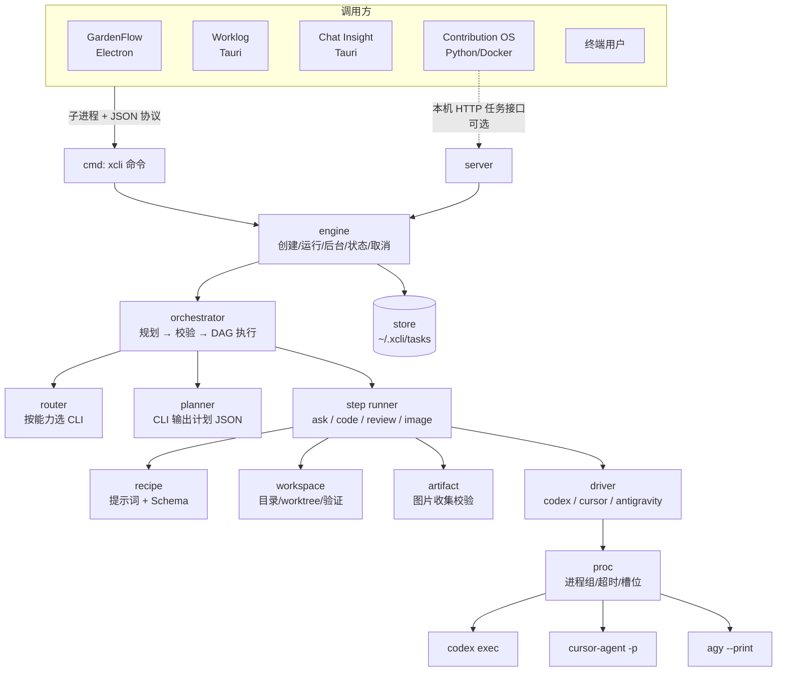

# 02 架构设计

## 1. 总览



一次请求的完整路径：

1. 调用方提交 `Request`（命令行参数或 JSON）。
2. `engine` 生成任务 ID，在 `~/.xcli/tasks/<id>/` 建目录，写入 `task.json`。
3. `orchestrator` 生成 `Plan`：能力明确时用规则直接生成（不调用模型）；`capability=auto` 时让一个 CLI 按 JSON Schema 输出计划，校验失败则退回规则。
4. DAG 执行器按依赖关系调度步骤，互不依赖的步骤并行；每个步骤由 step runner 选 CLI、拼提示词、调用驱动、收集结果。
5. 代码步骤进入"实现 → 验证 → 审查 → 修复"循环；CLI 不可用时切换到下一个候选 CLI。
6. 汇总成 `Result` 写入 `task.json`，同时输出给调用方。

## 2. 核心概念

| 概念 | 含义 |
| --- | --- |
| Agent | 一个可调用的 CLI：`codex`、`cursor`、`antigravity`。每个 Agent 对应一个 Driver。 |
| Capability | 请求级能力：`auto`（智能编排）、`ask`、`code`、`review`、`image`。 |
| Step Kind | 步骤类型：`ask`、`code`、`review`、`image`。一个计划由多个步骤组成。 |
| Request | 调用方的一次请求，见 [03 接口规范](03-interfaces.md#2-request)。 |
| Plan | 步骤 DAG。来源为 `rules`、`planner` 或 `explicit`（调用方直接给出）。 |
| Task | 一次请求的执行实例，有 ID、状态、事件流和结果，持久化在磁盘。 |
| Round | 代码步骤的一轮"实现/修复"。第 1 轮是实现，之后每轮是修复。 |
| Artifact | 任务产出的文件（目前主要是图片），带 MIME、尺寸、SHA-256。 |
| Event | 运行中的进度事件，JSONL 输出给调用方。 |

## 3. 包结构与依赖

```
main.go
cmd/                    命令行（薄层，只负责参数 → Request、输出格式）
internal/api/           协议 v1 公共类型：Request / Plan / Step / Result / Event（无依赖）
internal/config/        配置加载、默认值、合并
internal/proc/          进程启动、进程组取消、超时、逐行读取、并发槽位、GUI 场景 PATH 修复
internal/driver/        Driver 接口 + codex / cursor / antigravity 实现 + 错误分类
internal/health/        CLI 健康探测缓存与冷却（额度耗尽、未登录）
internal/store/         任务目录、task.json 原子写、events.jsonl 追加与读取
internal/recipe/        各步骤类型的提示词模板、内置 Schema、JSON 提取与 Schema 校验
internal/workspace/     工作目录准备、输入快照、git worktree、变更检测、验证命令、apply
internal/artifact/      图片收集、格式识别、尺寸读取、扩展名纠正
internal/orchestrator/  router、rules、planner、计划校验、step runner、DAG 执行器
internal/engine/        对外统一入口：Create / Run / Detach / Status / Wait / Cancel / Events / List
internal/server/        本机 HTTP 任务接口（第 5 阶段）
internal/testutil/fakecli/  测试用假 CLI
```

依赖方向（只能向下依赖）：

```
cmd, server → engine → orchestrator → {recipe, workspace, artifact, driver, health} → proc
所有包 → api, config, store（store 只依赖 api）
```

行数预算（非测试代码，目标）：driver 800、proc 300、store 250、config 200、health 120、recipe 350、workspace 450、artifact 200、orchestrator 1300、engine 400、server 300、api 200、cmd 900，合计约 5800。

## 4. 驱动层

### 4.1 接口

```go
type Permission string // "read" | "write" | "full"

type Invocation struct {
    Prompt     string
    Workdir    string     // 绝对路径，同时作为子进程 cwd
    Permission Permission
    Images     []string   // 参考图绝对路径
    SchemaFile string     // JSON Schema 文件绝对路径；空表示自由文本
    SessionID  string     // 非空表示续接原生会话
    Model      string     // 空表示用 CLI 自己的默认模型
    AddDirs    []string   // 工作区之外需要访问的目录
    Network    bool       // 沙箱内允许联网（目前只影响 codex）
    ExtraArgs  []string   // 来自配置，追加到参数末尾、提示词之前
}

type Driver interface {
    Name() string                                   // "codex" | "cursor" | "antigravity"
    Command() string                                // 可执行文件名，来自配置
    Build(inv Invocation) ([]string, error)         // 只拼参数；可执行文件路径、cwd、环境变量由调用方组装成 proc.Spec
    NewParser() Parser
    Probe(ctx context.Context, exe string, env []string) Health // 版本、登录状态（尽力而为）
    NativeSchema() bool                             // 是否有原生 Schema 参数
}

type Parser interface {
    Feed(line []byte) []Event           // 一行 stdout → 零或多个归一化事件
    Finish(exitCode int, stderrTail string) Result
}
```

`Result` 包含最终文本、会话 ID、用量（若有）、`ErrorKind`、错误信息、被拒绝的工具动作列表。

### 4.2 参数映射（2026-11-16 实测，详见 `driver-notes.md`）

**codex**（命令 `codex`）

| 场景 | 参数 |
| --- | --- |
| 新会话公共部分 | `exec --json --skip-git-repo-check -C <workdir>`，可选 `-m <model>`、`--output-schema <file>`、`-i `（每张图一个 `-i`）、`--add-dir <dir>`，最后 `-- <prompt>` |
| read | `-s read-only` |
| write | `-s workspace-write`；`Network=true` 时加 `-c sandbox_workspace_write.network_access=true` |
| full | `--dangerously-bypass-approvals-and-sandbox` |
| 续接 | `exec resume --json --skip-git-repo-check`，权限改用 `-c sandbox_mode="read-only"` 或 `"workspace-write"`，full 档仍用 `--dangerously-bypass-approvals-and-sandbox`（`exec resume` 不接受 `-s`、`-C`、`--add-dir`），可选 `-m`、`--output-schema`、`-i`，最后 `-- <session_id> <prompt>`；cwd 设为 workdir |

`-i` 接受多个值，所以提示词前必须有 `--`，否则会被当成图片路径。

**cursor**（命令 `cursor-agent`）

| 场景 | 参数 |
| --- | --- |
| 公共部分 | `-p --output-format stream-json --trust --workspace <workdir>`，可选 `--model <model>`、`--add-dir <dir>`，最后是提示词（位置参数） |
| read | `--mode ask` |
| write | `--force --sandbox enabled` |
| full | `--force --sandbox disabled` |
| 续接 | 公共部分加 `--resume <chat_id>` |
| Schema | 没有原生参数：提示词末尾附 Schema 并要求只输出 JSON，由 xcli 校验 |

`--trust` 是必须的：不传时新目录会卡在工作区信任确认，历史实测因此全部 BLOCKED。默认权限是"工作区内可写"，信任调用方指定的工作区与该决定一致。

2026-11-16 实测：Cursor 位置提示词之前加 `--` 也能正常执行；当前参数映射沿用表中形式。

**antigravity**（命令 `agy`）

| 场景 | 参数 |
| --- | --- |
| 公共部分 | `--output-format stream-json --print-timeout 0`，可选 `--model <model>`、`--json-schema <file>`、`--add-dir <dir>`，最后 `--print <prompt>`；cwd 设为 workdir |
| read | 初始映射 `--mode plan`；当前版本的 headless 行为见下方实测说明 |
| write | `--dangerously-skip-permissions --sandbox` |
| full | `--dangerously-skip-permissions` |
| 续接 | 公共部分加 `--conversation <id>` |

`--print-timeout 0` 表示不限时，由 xcli 自己控制超时（旧版硬编码 120 秒是长任务失败的原因之一）。print 模式没有人能点审批，write 模式必须自动批准，否则会出现 `denied_actions`；用 `--sandbox` 限制终端命令的范围。

2026-11-16 实测：Antigravity 1.5.2 的 `--mode plan` 在读取文件时会触发 command 权限拒绝，结果仍可能是 `SUCCESS`、空正文和非空 `denied_actions`。增加 `--sandbox` 后能读取文件，但本次回复生成了实现计划并要求点击 Proceed 批准执行。此映射存在无交互只读任务的适配问题；同类任务可用 Codex 或 Cursor 完成，详见 `driver-notes.md`。

### 4.3 事件解析要点（来自旧版 `stream.go` 的经验）

| CLI | 会话 ID | 最终文本 | 结束标志 | 失败信号 |
| --- | --- | --- | --- | --- |
| codex | `thread.started` 的 `thread_id` | 最后一个 `item.completed` 且 `item.type == "agent_message"` 的 `item.text` | `turn.completed`（带 usage） | `turn.failed`；`error` 事件——但匹配 `^Reconnecting\.\.\. n/m` 的是重连通知，不算失败；`usage_limit_exceeded` / `quota_exceeded` / "hit your usage limit" 归为 `quota` |
| cursor | `system` 或 `result` 的 `session_id` | 最后一条 `assistant` 消息的 `message.content[].text`；`result.result` 兜底（实测会拼接中间说明） | `type == "result"` | `result.subtype != "success"` 或 `is_error == true`；错误模型也可能只输出 stderr 并非零退出 |
| antigravity | `step_update.conversation_id` / `result.conversation_id` | 有 `result.structured_output` 时使用该 JSON，否则取 `result.response` | `event == "result"` | `result.status != "SUCCESS"`，错误详情在 `result.error`；`result.denied_actions` 非空时即使状态是 SUCCESS 也判为 `permission_denied` |

用量：Codex 从 `turn.completed.usage.input_tokens/output_tokens` 提取；Cursor 从 `result.usage.inputTokens/outputTokens` 提取；Antigravity 从 `result.usage.input_tokens/output_tokens/total_tokens` 提取。Antigravity 的 `denied_actions` 实测为对象数组，元素含 `action`、`display_name`；驱动的 `Denied []string` 提取 `action`，同时兼容字符串元素。Antigravity 工具进度从 `step_update.tool_name` 和 `tool_info` 提取。

进度事件归一化成 `message`（助手文本片段）、`tool`（工具名）、`notice`（重连等），只用于展示，不影响结果判定。没有结束标志时判 `protocol` 错误。

### 4.4 错误分类

| ErrorKind | 识别依据 | 能否切换到其他 CLI |
| --- | --- | --- |
| `not_installed` | 找不到命令 | 能 |
| `auth` | stderr 或事件里出现未登录、401、"login"、"not authenticated" 等 | 能 |
| `quota` | 额度、429、rate limit、usage limit | 能 |
| `trust` | Cursor 工作区信任提示 | 能 |
| `permission_denied` | `denied_actions`、沙箱拒绝 | 不能（换 CLI 解决不了权限设置问题） |
| `no_artifact` | 图片步骤完成但没收集到有效图片 | 仅图片步骤能 |
| `schema_mismatch` | 一轮修复后输出仍不符合 Schema | 不能 |
| `timeout` / `cancelled` | xcli 控制 | 不能 |
| `protocol` | 没有结束事件、JSON 损坏 | 不能 |
| `failed` | 其他非零退出 | 不能 |

识别规则集中在每个驱动的 `classify` 函数里，表驱动，配有样本测试。

### 4.5 健康状态

- `Probe`：`exec.LookPath` + `--version`（5 秒超时）；登录检查尽力而为——codex 用 `codex login status`，cursor 用 `cursor-agent status --format json`，antigravity 没有对应命令，记为 `unknown`。
- 结果缓存在 `~/.xcli/cache/health.json`，有效期 10 分钟。
- 运行中出现 `auth` 或 `quota` 时写入冷却：`quota` 冷却 30 分钟，`auth` 冷却 10 分钟。冷却中的 CLI 不参与路由。`xcli agents --reset` 清除冷却。
- 探测不消耗模型额度，也不需要任何授权步骤。

## 5. 步骤类型（recipe）

每种步骤类型都有一个提示词模板（`internal/recipe/prompts/*.md`，用 `embed` 打包），由 xcli 在用户需求外面包一层"执行约定"。模板统一要求：用与用户需求相同的语言回复；不要 git commit / push。

| Kind | 权限 | 工作目录 | 输出约定 | 结果提取 |
| --- | --- | --- | --- | --- |
| `ask` | read | 请求的 workdir；没有则用任务临时目录 | 自由文本；有 Schema 时只输出 JSON | 最终文本；有 Schema 时提取 JSON 并校验，不符合则在同一会话里要求修正一次 |
| `code` | 请求权限（默认 write） | 请求的 workdir（或 worktree） | 总结改了哪些文件、原因、如何验证 | 最终文本 + 变更（git diff 或文件快照对比） |
| `review` | read | 被审查的目录 | 内置审查 Schema（见下） | 解析出 verdict / issues |
| `image` | write | 请求的 workdir 或任务临时目录 | 把图片保存到指定输出目录，最终回复 `{"files":[...]}` | 由 `artifact` 收集并校验图片 |

审查 Schema（严格模式，见 5.1）：

```json
{
  "type": "object",
  "additionalProperties": false,
  "required": ["verdict", "summary", "issues"],
  "properties": {
    "verdict": {"type": "string", "enum": ["pass", "changes_requested"]},
    "summary": {"type": "string"},
    "issues": {
      "type": "array",
      "items": {
        "type": "object",
        "additionalProperties": false,
        "required": ["severity", "file", "description"],
        "properties": {
          "severity": {"type": "string", "enum": ["blocker", "major", "minor"]},
          "file": {"type": ["string", "null"]},
          "description": {"type": "string"}
        }
      }
    }
  }
}
```

只有存在 `blocker` 或 `major` 问题时才触发修复；只有 `minor` 时按通过处理，问题照常写进结果，避免无休止地挑小毛病。

### 5.1 Schema 注意事项

codex 的 `--output-schema` 走 OpenAI Structured Outputs 严格模式：每个 object 必须写 `additionalProperties: false`，且所有属性都要列进 `required`；可选字段用 `"type": ["string", "null"]` 表达。xcli 内置的 Schema 都按这个规则写。调用方传入的 Schema 不符合严格模式时，codex 可能拒绝，此时驱动去掉原生参数、改成提示词约束 + xcli 校验（与 cursor 相同的处理方式）。

## 6. 编排

### 6.1 规划

```
Request
  ├─ 带 plan（explicit） ─────────────→ 校验 → 执行
  ├─ capability ∈ {ask, review, image} → 规则：单步骤
  ├─ capability = code ────────────────→ 规则：一个 code 步骤，review_by = auto（可关闭）
  └─ capability = auto ────────────────→ planner（CLI 输出计划 JSON）
                                           ├─ 成功且校验通过 → 执行
                                           └─ 失败 → 关键词分类 → 退回规则
```

关键词分类只做兜底：含"图/图片/插画/封面/logo/image/画"→ image；含"修复/实现/重构/代码/bug/fix/implement/refactor/测试"且有 workdir → code；其余 → ask。

### 6.2 router：给步骤选 CLI

```
候选 = 请求 agents（未指定则为全部启用的 CLI）
      ∩ 已安装 ∩ 不在冷却中 ∩ strengths[kind] > 0
排序 = strengths[kind] 降序 → 请求 agents 中的顺序 → 配置顺序（codex, cursor, antigravity）
review 步骤：优先排除被审查步骤所用的 CLI；只剩它自己时不做审查，并发出 notice 事件
```

默认 strengths（可在配置里改；依据是历史实测：codex 与 antigravity 生图通过，cursor 生图受信任问题阻塞未验证）：

| CLI | code | review | ask | image | plan |
| --- | --- | --- | --- | --- | --- |
| codex | 3 | 2 | 2 | 2 | 3 |
| cursor | 3 | 3 | 2 | 1 | 1 |
| antigravity | 2 | 2 | 3 | 3 | 2 |

### 6.3 planner：让 CLI 生成计划

- 用配置里的 `planner`（默认 codex），失败时换 plan 分数最高的另一个可用 CLI，最多尝试 2 个；只读权限，超时 3 分钟。
- 输入：用户需求、workdir 概况（是否 git 仓库、顶层最多 50 个条目）、输入文件列表、可用 CLI 及其 strengths 和一句说明、限制（最多 `max_steps` 步）。
- 输出 Schema（严格模式；`agent` 的 enum 由可用 CLI 动态生成，并包含 `"auto"`）：

```json
{
  "type": "object",
  "additionalProperties": false,
  "required": ["reasoning", "steps"],
  "properties": {
    "reasoning": {"type": "string"},
    "steps": {
      "type": "array",
      "minItems": 1,
      "maxItems": 6,
      "items": {
        "type": "object",
        "additionalProperties": false,
        "required": ["id", "kind", "agent", "instruction", "depends_on", "review_by", "output"],
        "properties": {
          "id": {"type": "string", "pattern": "^[a-z0-9_-]{1,32}$"},
          "kind": {"type": "string", "enum": ["ask", "code", "review", "image"]},
          "agent": {"type": "string", "enum": ["auto", "codex", "cursor", "antigravity"]},
          "instruction": {"type": "string"},
          "depends_on": {"type": "array", "items": {"type": "string"}},
          "review_by": {"type": ["string", "null"]},
          "output": {"type": ["string", "null"]}
        }
      }
    }
  }
}
```

- 规划提示词里的规则：简单需求只用 1 步；有代码改动时建议设置 `review_by`；互不依赖的步骤不要加依赖，以便并行；生图交给 image 分数高的 CLI；每一步的 `instruction` 要能独立执行。
- 计划校验（`ValidatePlan`）：ID 唯一；依赖都存在且无环；agent 属于可用集合或为 `auto`；步数不超过 `max_steps`；请求权限为 read 时不允许 `code` 和 `image` 步骤；`review_by` 只能出现在 `code` 步骤上。校验失败按 6.1 退回规则。
- `xcli plan` 或 `plan_only=true` 只返回计划，状态为 `planned`。调用方可以修改后通过 `plan` 字段提交执行。

### 6.4 DAG 执行器

- 依赖都完成（`completed` 或 `needs_attention`）的步骤进入就绪队列；任何依赖 `failed` 的步骤标记为 `skipped`；不相关的分支继续执行。
- 并行上限：单任务 `max_parallel`（默认 3）；每个 CLI 还有全局并发槽位（默认 2，跨进程生效，见 8.3）。
- 写冲突：同一 workdir 上的 `code` 步骤串行执行（每个 workdir 一把锁）；`image` 步骤各自写入 `out/<step-id>/`，可以并行；`ask` / `review` 只读，可以并行。
- 交接：下游步骤的提示词里附上游步骤的"交接摘要"——最终文本（截断到 8 KB）、产物路径列表、变更文件列表。文件本身通过路径共享，不内联。
- 切换：步骤失败且 ErrorKind 允许切换（4.4）、请求 `fallback=true`（默认）时，router 排除已失败的 CLI 重新选择，最多切换 2 次；每次切换发出 `agent.fallback` 事件，并记录在 `StepResult.fallbacks`。请求指定了 `agent` 时不切换。

### 6.5 代码步骤循环

```
round = 1：code（新会话，权限 = 请求权限）
loop:
  有 verify    → 逐条执行；任一失败 → feedback = 失败命令 + 日志尾部 → 去 fix
  有 review_by → review（另一个 CLI，只读，审查 Schema）
                   verdict = pass 或只有 minor → 完成（completed）
                   否则 feedback = blocker/major 问题 → 去 fix
  都没有       → 完成（completed）
fix:
  round > max_fix_rounds → 完成（needs_attention，附未解决的反馈）
  round++ ：code（续接同一会话；续接失败则开新会话，并附原需求 + 上一轮总结），提示词 = 修复模板 + feedback
  回到 loop
```

`max_fix_rounds` 默认 2，即最多 3 轮实现/修复。审查者拿到的材料：原始需求、实现者的总结、xcli 生成的 diff 文件路径（`steps/<id>-r<n>/review.diff`）。

### 6.6 状态

- 任务：`queued` → `running` → `completed` | `needs_attention` | `failed` | `cancelled`；只规划时为 `planned`；请求不合法时为 `invalid`（不落盘）。
- 步骤：`pending` → `waiting`（等并发槽位）→ `running` → `completed` | `needs_attention` | `failed` | `skipped` | `cancelled`。
- 汇总规则：任一步骤 `failed` → 任务 `failed`；否则任一步骤 `needs_attention` → 任务 `needs_attention`；否则 `completed`。

## 7. 权限与工作区

### 7.1 三档权限

| 档位 | 含义 | 默认用于 |
| --- | --- | --- |
| `read` | 只读，不改文件 | `ask`、`review`、规划；请求可以显式要求全部只读 |
| `write` | 工作区内可写、可执行命令；沙箱内默认允许联网（`network: true`，可关） | `code`、`image`（默认） |
| `full` | 跳过所有审批与沙箱 | 只有请求显式指定时 |

xcli 本身不是沙箱，权限隔离依赖各 CLI 的沙箱；`write` 档会信任调用方指定的工作区（Cursor `--trust`），并自动批准 Antigravity 的工具调用（受 `--sandbox` 约束）。

### 7.2 工作目录

| 情况 | 工作目录 |
| --- | --- |
| 请求给了 `workdir`，未要求隔离 | 直接使用（和直接运行 CLI 的行为一致） |
| 请求给了 `workdir` 且 `isolate=true`，目录是 git 仓库 | `git worktree add -b xcli/<task-id> ~/.xcli/tasks/<id>/worktree HEAD`；仓库有未提交改动时发 notice：worktree 基于 HEAD，未提交的改动不会带入 |
| 请求没给 `workdir` | `~/.xcli/tasks/<id>/work/`（空目录） |

- 输入文件（`inputs`、`images`）复制到 `~/.xcli/tasks/<id>/inputs/` 做快照（总量上限 200 MB），提示词里用绝对路径引用；该目录不在工作目录内时通过 `AddDirs` 传给 CLI（codex 续接时不支持 `--add-dir`，codex 的只读沙箱本身允许读取工作区之外的文件）。
- 变更检测（全程不修改用户仓库的索引和工作区）：
  - git 仓库：第一轮 code 之前记录基线——`git stash create` 的输出（工作区有未提交改动时得到一个临时提交，不影响工作区）或 `HEAD`，以及 `git ls-files --others --exclude-standard` 列出的未跟踪文件。之后的变更 = `git diff --binary <基线>`（已跟踪文件）+ 新出现的未跟踪文件逐个 `git diff --no-index --binary /dev/null <file>`。这样用户原有的未提交改动不会算进本次任务。
  - 非 git 目录：步骤前后各做一次 `(path, size, mtime)` 快照对比，跳过 `.git`、`node_modules`、`.venv`、`dist`、`build`，最多 2 万个文件；只报告变更文件列表，不生成 diff。
- `xcli apply <task-id>`：把隔离任务的 `changes.patch` 用 `git apply --3way` 应用回原仓库，成功后可选删除 worktree。

### 7.3 验证命令

`verify` 是 shell 命令字符串，用 `sh -c` 在工作目录执行；每条默认超时 10 分钟；日志写入 `steps/<id>-r<n>/verify-<k>.log`，失败时取最后 16 KB 作为修复反馈。调用方要对自己传入的命令负责。

## 8. 进程与生命周期

### 8.1 前台与后台

- 前台（默认）：当前进程直接运行编排，事件实时输出；Ctrl-C 取消任务。
- 后台（`--detach`）：`engine.Detach` 用 `Setsid` 启动 `xcli __worker <task-id>`（隐藏命令），stdout/stderr 重定向到任务目录的 `worker.log`，立刻返回任务 ID。之后用 `status` / `wait` / `logs` / `cancel` / `result` 操作。
- `task.json` 里记录运行者 PID。查询时如果状态是 `running` 但 PID 已不存在，就把任务标记为 `failed`，`error.kind = "worker_lost"`。

### 8.2 子进程

- 每个 CLI 进程用 `Setpgid` 启动独立进程组；取消或超时时先向进程组发 SIGTERM，5 秒后 SIGKILL。
- stdout 逐行交给 Parser，同时原样写入 `steps/<id>-r<n>/stdout.jsonl`；stderr 写入 `stderr.log`，并在内存保留最后 64 KB 供错误分类。
- 单行上限 8 MB，超出的行丢弃并记 notice。
- 环境变量：继承 xcli 的完整环境，叠加配置中该 agent 的 `env`。
- 超时：步骤默认 20 分钟，任务默认 90 分钟，规划 3 分钟，均可配置。

### 8.3 并发槽位

每个 CLI 有 `max_concurrency` 个槽位（默认 2），对应文件 `~/.xcli/locks/<agent>-<n>.lock`，用 `flock(LOCK_EX|LOCK_NB)` 抢占，进程退出时自动释放。抢不到时每秒重试，并发出 `step.waiting` 事件。这样多个应用同时调用 xcli 时也不会把同一个 CLI 开得过多。

### 8.4 GUI 应用的 PATH 问题

macOS 上从 Dock 启动的桌面应用不会继承终端里的 PATH，xcli 和它启动的 CLI（cursor-agent 依赖 node）可能找不到命令。处理方式：

1. 配置 `path` 非空时直接用它作为子进程 PATH。
2. 否则执行一次 `$SHELL -lic 'printf %s "$PATH"'`（3 秒超时），与当前 PATH 合并去重，结果缓存在 `~/.xcli/cache/env.json`，有效期 24 小时。
3. 再追加常见目录：`~/.local/bin`、`/opt/homebrew/bin`、`/usr/local/bin`。

查找 CLI 命令时使用合并后的 PATH。应用侧应该用 xcli 的绝对路径启动它。

## 9. 存储

根目录 `~/.xcli`（环境变量 `XCLI_HOME` 可覆盖）：

```
~/.xcli/
  config.yaml                  可选
  cache/health.json            健康探测与冷却
  cache/env.json               登录 shell 的 PATH
  locks/<agent>-<n>.lock       并发槽位
  server.token                 HTTP 接口令牌（0600）
  tasks/<task-id>/
    task.json                  请求 + 计划 + 步骤状态 + 结果（写临时文件后 rename，保证原子）
    events.jsonl               事件流（追加写）
    worker.log                 后台运行时的输出
    inputs/                    输入快照
    work/                      没有 workdir 时的临时工作目录
    out/<step-id>/             默认产物目录
    worktree/                  isolate 时的 git worktree
    changes.patch              代码改动
    steps/<step-id>-r<round>/  prompt.md、stdout.jsonl、stderr.log、result.json、verify-<k>.log、review.diff
```

任务 ID 格式：`t-20261113-170102-a3f9`（时间 + 4 位随机十六进制）。`xcli gc --older-than 7d` 清理已结束的旧任务（会先删除对应的 worktree 和 `xcli/<task-id>` 分支）。

## 10. 配置

所有字段都是可选的，没有配置文件时使用下面的默认值：

```yaml
defaults:
  permission: write        # read | write | full
  network: true            # write 档沙箱内是否允许联网
  review: auto             # code 任务自动安排另一个 CLI 审查：auto | off
  fallback: true           # CLI 不可用时自动切换
  max_fix_rounds: 2
  max_steps: 6
  max_parallel: 3
  step_timeout: 20m
  task_timeout: 90m
  planner_timeout: 3m
  verify_timeout: 10m
  planner: codex           # 智能编排时负责规划的 CLI
path: ""                   # 子进程 PATH；空表示自动探测
agents:
  codex:
    command: codex
    enabled: true
    model: ""              # 空表示用 CLI 默认模型
    max_concurrency: 2
    env: {}
    extra_args: []
    artifact_dirs: ["~/.codex/generated_images"]
    strengths: {code: 3, review: 2, ask: 2, image: 2, plan: 3}
  cursor:
    command: cursor-agent
    artifact_dirs: ["~/.cursor/projects"]
    strengths: {code: 3, review: 3, ask: 2, image: 1, plan: 1}
  antigravity:
    command: agy
    artifact_dirs: ["~/.gemini/antigravity-cli/brain"]
    strengths: {code: 2, review: 2, ask: 3, image: 3, plan: 2}
```

`artifact_dirs` 来自第 0 阶段实测。原生环境变量 `CODEX_HOME` 非空时，Codex 默认目录改用该目录下的 `generated_images`；其余使用上面的常规路径。

合并规则：用户配置逐字段覆盖默认值；`agents` 下出现的字段覆盖同名 agent 的对应字段；未知字段报错（YAML `KnownFields`）。`xcli config show` 输出生效后的配置。

## 11. 生图细节

1. 输出目录：请求的 `output_dir`，否则 `~/.xcli/tasks/<id>/out/<step-id>/`；目录不在工作目录内时加入 `AddDirs`。
2. 提示词里按 CLI 写明使用哪个内置能力（来自历史实测）：
   - codex：使用内置图片生成工具（`image_gen`）；参考图通过 `-i` 附带，编辑时会配合 `view_image` 使用。
   - antigravity：调用内置 `image-generator` 子代理（不要用 `--agent image-generator`，那是选择主 Agent，会报 unknown agent）。
   - cursor：使用内置 `GenerateImage` 工具。
3. 要求把最终图片保存到输出目录、文件名以步骤 ID 开头，最终回复 `{"files": ["<绝对路径>"]}`（codex / antigravity 用原生 Schema 强制）。
4. 收集（`artifact.CollectImages`）：
   - 输出目录里修改时间晚于步骤开始的文件；
   - 最终 JSON 里 `files` 列出的路径，以及文本中匹配 `(/[^\s"'<>]+\.(png|jpe?g|webp|gif))` 的绝对路径；
   - 该 CLI `artifact_dirs` 下修改时间晚于步骤开始的图片（最多扫描 3 层、2000 个条目）。
   输出目录之外的文件复制进输出目录。
5. 校验：用 `image.DecodeConfig`（png / jpeg / gif / webp）读出格式和尺寸，计算 SHA-256；扩展名与真实格式不一致时改成正确的扩展名（例如 CLI 把 JPEG 存成了 `.png`）；无法解码的文件丢弃。
6. 一张有效图片都没有 → `no_artifact`，按 6.4 切换到下一个 image 分数大于 0 的 CLI。
7. 改图：`images` 里放参考图；提示词要求不覆盖原图、生成新文件。

## 12. 错误处理原则

- 请求不合法（缺 goal、路径不存在、agent 名未知、权限值非法、Schema 不是合法 JSON）→ 不建任务，返回 `status: invalid`，退出码 2。
- 运行期错误一律落到 `Result.error`（`kind`、`message`、`step_id`），`--json` 模式下 stdout 始终是一个完整的 Result JSON。
- 错误信息给出下一步该做什么，例如 `auth` → "请在终端运行 `codex login`"，`quota` → "codex 额度已用尽，已切换到 cursor" 或 "所有可用 CLI 额度不足"。
- 不把原生 stderr 原样塞进 `message`（可能含隐私）；原始输出保留在步骤目录里供排查。

## 13. 测试策略

| 层 | 方法 |
| --- | --- |
| driver | 参数拼装用表驱动测试断言完整 argv；解析用 `internal/driver/testdata/<agent>/*.jsonl` 真实录制样本（第 0 阶段产出）回放 |
| proc | 用 `sh -c` 子进程测试超时、取消、进程组清理、逐行读取、槽位互斥 |
| recipe / artifact / workspace / store / config | 普通单元测试；图片用代码生成 PNG / JPEG 测试 |
| orchestrator / engine | 用 fakecli：一个 Go 小程序，在测试里编译成 `codex` / `cursor-agent` / `agy` 放到 PATH 最前面，按 `XCLI_FAKE_SCRIPT` 指定的剧本回放样本、写文件、休眠、以指定退出码退出，并把收到的 argv 记录到文件 |
| 真实冒烟 | `scripts/smoke.sh`，由你手动运行（约 10 次真实调用，会消耗额度） |

所有测试在 `go test ./... -race` 下通过，单元测试不发起真实模型调用。

## 14. 与旧版的对应

| 旧版 | v2 |
| --- | --- |
| `run --agent X` | `ask -a X` / `code -a X` |
| `task`（固定流水线） | `code`（实现-验证-审查-修复循环）/ `do`（自动规划） |
| `jobs` / `runs` / `task status` | `status` / `wait` / `logs` / `result` / `list` |
| `resume RUN_ID` | `resume <task-id> "<追加要求>"` |
| `launches window/budget` | 删除 |
| `model` / `agent-gateway` / `--experimental-gateways` | 删除 |
| `mcp serve` | 删除 |
| `use`（交互式启动原生 CLI） | 删除，直接运行原生 CLI 即可 |

## 15. 后续扩展（不在 v2.0 范围）

- `xcli mcp`：把 engine 暴露成 MCP 工具，供 Claude Code / Cursor 等编码 Agent 调用。
- best-of-N：同一编码任务交给多个 CLI 在不同 worktree 中并行实现，由审查者选出最好的方案。
- 交互式补充信息（任务中途向调用方提问）。
